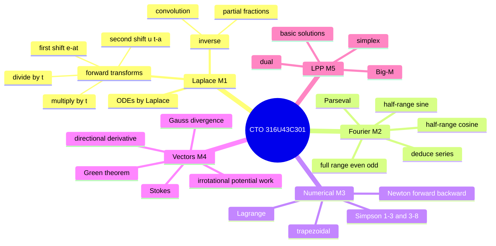
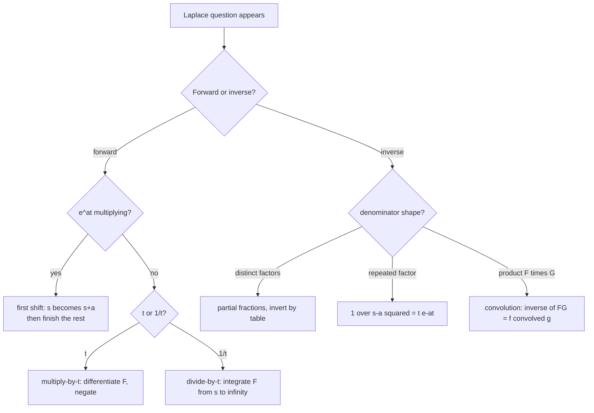
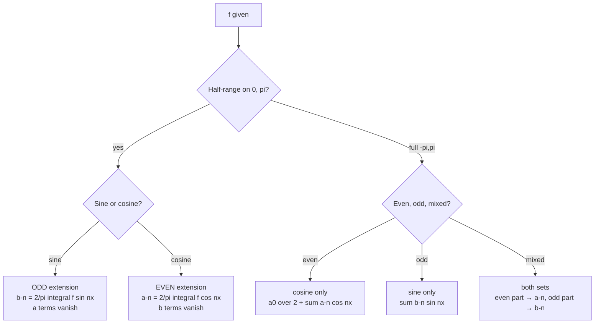
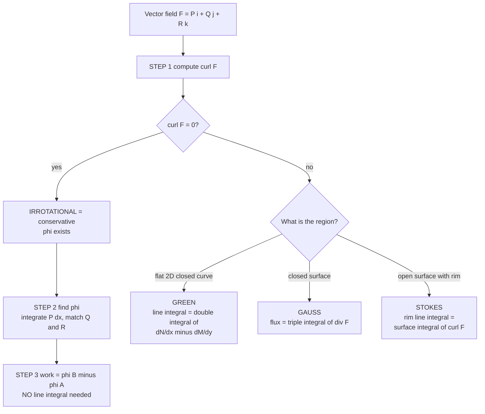
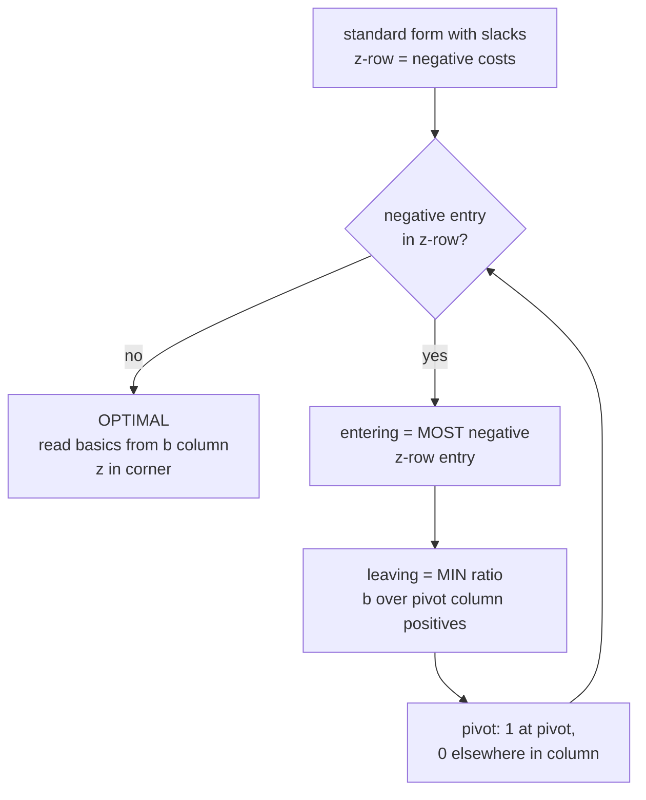
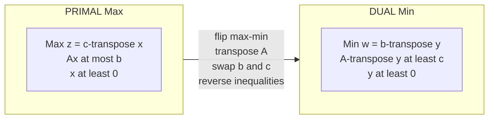
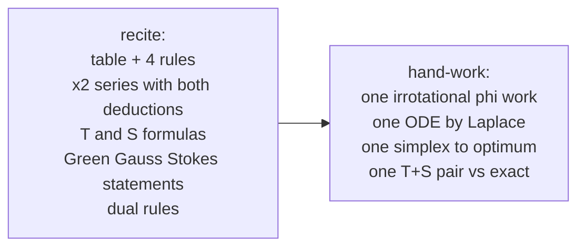

# CTO — The Complete Visual Study Guide
*Calculus, Transforms & Optimization (316U43C301) · everything you must go over, in one file*
*Built from: RAI MJ25 + ND25 real papers + COMP/EXTC sister papers + code-verified answers*

## OFFICIAL MODULE WEIGHTS — Nov 2026 ESE (with options)

| Priority | Module | Offered marks | Verdict |
|---|---|---|---|
| 1 | M1 Laplace Transform | **20** | Joint-heaviest. Property table + inverse pairs + one ODE-solve-by-Laplace, drilled to automatic. |
| 2 | M4 Vector Calculus | **20** | Joint-heaviest AND most predictable (Q4 fixed + Green's/Gauss/Stokes). 100% hit-rate family. |
| 3 | M2 Fourier Series | 15 | Half-range short (Q1) + full-range-with-deduce 10 (Q3 option). |
| 4 | M5 LPP | 15 | Dual short + simplex 10. Big-M = rotation insurance. |
| 5 | M3 Numerical Methods | 10 | ONE skippable 10. Newton-forward + trap/Simpson — one method each, then stop. |

*Weights received 11-Nov-2026; reconciled against both real papers (they offered M1 15/M5 20 — the official table moves 5 offered marks from LPP into Laplace: expect a second Laplace item, most likely ODE-by-Laplace).*

**How to use:** CTO is a METHOD subject — the marks are in knowing WHICH tool a question wants, then executing cleanly. Every formula here is exam-complete; verified numbers were machine-checked.

---

## 0 · THE SUBJECT IN ONE PICTURE

**Exam shape:** Q1 any-two×5 · Q2 any-one×10 · Q3 any-one×10 · Q4 both×5 (irrotational archetype in 100% of papers) · Q5×5+5.

---

# MODULE 1 — Laplace Transform

## 1.1 The transform table (memorize — it's the toolkit)

| f(t) | F(s) |
|---|---|
| 1 | 1/s |
| tⁿ | n!/sⁿ⁺¹ |
| e⁻ᵃᵗ | 1/(s+a) |
| sin at | a/(s²+a²) |
| cos at | s/(s²+a²) |
| sinh at | a/(s²−a²) |
| cosh at | s/(s²−a²) |
| e⁻ᵃᵗsin bt | b/((s+a)²+b²) |
| t·e⁻ᵃᵗ | 1/(s+a)² |
| δ(t−a) | e⁻ᵃˢ |
| u(t−a) | e⁻ᵃˢ/s |

## 1.2 The four rules (each rule = one exam question)

| Rule | Statement | Use when |
|---|---|---|
| **First shift** | L{e⁻ᵃᵗf(t)} = F(s+a) | exponential × function |
| **Second shift** | L{f(t−a)u(t−a)} = e⁻ᵃˢF(s) | delayed function × step |
| **Multiply by t** | L{t·f(t)} = −F′(s) | t × function |
| **Divide by t** | L{f(t)/t} = ∫ₛ^∞ F(u)du | f(t)/t |

## 1.3 Worked archetypes (asked / verified)

**L{t e⁻ᵗ cosh 2t} (MJ25):** cosh2t = (e²ᵗ+e⁻²ᵗ)/2 → e⁻ᵗcosh2t = (eᵗ+e⁻³ᵗ)/2 → first-shift: ½[1/(s−1)+1/(s+3)]; then multiply-by-t: −d/ds of that → **½[1/(s−1)² + 1/(s+3)²]**.

**From definition (integration):** L{e⁻ᵃᵗsin bt} = ∫₀^∞ e⁻ˢᵗe⁻ᵃᵗ sin bt dt = **b/((s+a)²+b²)**.

**L{sin t/t}:** ∫ₛ^∞ du/(u²+1) = **tan⁻¹(1/s)**. **L{t sin 2t}** = −d/ds[2s/(s²+4)²] = **2(s²−4)/(s²+4)²**.

**Square wave** (±1 alternating, period 2a): **L = (1/s)tanh(as/2)**.

**Second-shift example:** L{u(t−2)(t−2)²} = e⁻²ˢ·2/s³.

## 1.4 Inverse transforms

**Partial fractions:** L⁻¹{(3s+7)/(s²−2s−3)}: (s−3)(s+1) → A/(s−3)+B/(s+1), A=4, B=−1 → **4e³ᵗ−e⁻ᵗ**.
**Complete-the-square:** (s+4)/(s²+4s+13) = (s+2)+2 over (s+2)²+9 → **e⁻²ᵗ(cos3t + (2/3)sin3t)**.
**The log trick (ND25):** L⁻¹{log((s+4)/s)}: F′ = 1/(s+4) − 1/s; L⁻¹{F′} = −t·f → f = (1−e⁻⁴ᵗ)... → answer **(1−e⁻⁴ᵗ)/t**.
**Convolution:** L⁻¹{1/(s(s+1)(s+2))} = ½ − e⁻ᵗ + ½e⁻²ᵗ (PF route; convolution of 1 and e⁻ᵗ gives same). L⁻¹{s/(s²+1)²} = **½t sin t**.

## 1.5 ODEs by Laplace — the 4-step algorithm
1. Transform both sides (y″ → s²Y − s·y(0) − y′(0); y′ → sY − y(0)).
2. **Substitute initial conditions immediately.**
3. Solve algebraically for Y(s); simplify (PF / complete square).
4. Invert term by term.

**Worked (verified numerically):** y″+y = t, y(0)=1, y′(0)=0 → (s²+1)Y = 1/s² + s → Y = 1/(s²(s²+1)) + s/(s²+1) → **y = t − sin t + cos t**.
**Worked (verified):** (D²−3D+2)y = 4e²ᵗ, y(0)=−3, y′(0)=5 → **y = −7eᵗ + (4+4t)e²ᵗ**.

---

# MODULE 2 — Fourier Series

## 2.1 Which series? (the selector)

**Full-range formulas:** a₀ = (1/π)∫f dx, aₙ = (1/π)∫f cos nx dx, bₙ = (1/π)∫f sin nx dx (all −π→π).

## 2.2 The standard results (learn these three cold)

| Function, range | Series | Deducible |
|---|---|---|
| x², (−π,π) | π²/3 + 4Σ(−1)ⁿcos nx/n² | x=π → **Σ1/n² = π²/6** |
| x, (−π,π) | 2Σ(−1)ⁿ⁺¹sin nx/n | x=π/2 → **1−1/3+1/5−… = π/4** |
| (π−x)/2, (0,2π) | Σ sin nx/n | x=π/2 → odd harmonics |

## 2.3 Half-range worked patterns
**f = 1+x sine series on (0,π) (MJ25):** bₙ = (2/π)∫₀^π(1+x)sin nx dx = **(2/(nπ))[1 + (π+1)(−1)ⁿ⁺¹]** — by parts; boundary sine terms vanish.
**f = x cos x sine series (ND25):** bₙ = (2/π)∫x cos x sin nx dx — product-to-sum, then by parts twice; n=1 term special (b₁ = 0), general bₙ involves 1/(n²−1).
**cosh/sinh:** cosh x = sinhπ/π + (2sinhπ/π)Σ(−1)ⁿcos nx/(n²+1); sinh x = (2sinhπ/π)Σ n(−1)ⁿ⁺¹sin nx/(n²+1).

## 2.4 Dirichlet's conditions (4 points = full marks)
f must be: (1) single-valued, (2) finite, (3) piecewise continuous — finitely many discontinuities, (4) finitely many maxima/minima per period. At a discontinuity the series converges to the **average of left and right limits**.

## 2.5 Parseval + complex form
- Half-range sine: **Σbₙ² = (2/π)∫₀^π f² dx** (identity for computing series sums).
- Complex form: f = Σcₙe^(inx), cₙ = (1/2π)∫f e^(−inx) dx; cₙ = (aₙ−ibₙ)/2.

---

# MODULE 3 — Numerical Methods

## 3.1 Interpolation — pick by table shape

| Situation | Formula |
|---|---|
| Target near TOP of table | Newton FORWARD: y = y₀ + uΔy₀ + u(u−1)/2!·Δ²y₀ + …, u = (x−x₀)/h |
| Target near BOTTOM | Newton BACKWARD: same with ∇ from last row, u = (x−xₙ)/h |
| UNEQUAL spacing | **Lagrange**: f(x) = Σ yᵢ·Π(x−xⱼ)/(xᵢ−xⱼ) |

**Worked (verified):** Lagrange {1,2,4,6}→{2,3,16,40}, f(3) = **7.85**. Newton forward on steam table (MJ25): build Δ-column, u = (142−x₀)/h, take terms until they vanish.
**Operator relations (prove any two):** E = 1+Δ, Δ = E−1, ∇ = 1−E⁻¹ (proof: yᵣ₊₁ = Eyᵣ = yᵣ + Δyᵣ).

## 3.2 Integration — the two workhorses

| Rule | Formula | n requirement |
|---|---|---|
| Trapezoidal | T = h/2[y₀+yₙ + 2(middle sum)] | any n |
| Simpson 1/3 | S = h/3[y₀+yₙ + 4(odd) + 2(even)] | n EVEN |
| Simpson 3/8 | 3h/8[end + 3(pattern) + 2...] | n multiple of 3 |

**Worked pair 1 (MJ25, verified):** ∫₂⁸ x log x dx, h=1: nodes 2..8, y = 1.386, 3.296, 5.545, 8.041, 10.750, 13.644, 16.636 → T = **50.27**, S = **50.16**, exact = [x²/2·lnx − x²/4]₂⁸ = **50.156** — Simpson closer.
**Worked pair 2 (ND25, verified):** ∫₁¹⁰ dx/x, h=0.5 → T = 2.379... (with h=1: T = 2.379), S = **2.305** vs ln10 = **2.3026** — Simpson closer again.
**Worked 3/8 (verified):** ∫₀¹ dx/(1+x²), h=1/6 → **0.7854 ≈ π/4**.

**The one-line exam takeaway:** Simpson fits a parabola through triplets → error O(h⁴) vs trapezoid's O(h²) → always quote "Simpson is more accurate" WITH the two computed values.

---

# MODULE 4 — Vector Calculus

## 4.1 The four-theorem engine (Q4 = this every year)

## 4.2 The irrotational archetype (100% of papers — full method)

**Step 1:** curl F = |i j k; ∂x ∂y ∂z; P Q R| — set all components to verify 0.
**Step 2:** φ = ∫P dx (+ g(y,z)) → ∂φ/∂y = Q gives g → ∂φ/∂z = R gives h.
**Step 3:** W = φ(B) − φ(A).

**Worked (MJ25 family):** F = (2xy+z³)i + (x²+2yz²)j + (3xz²+2y²z)k → curl = 0 ✓ → φ = x²y + z³x + y²z² → evaluate at endpoints. **VERIFY φ by differentiating back — always.**

## 4.3 Green / Gauss / Stokes — statements + worked
- **Green:** ∮M dx + N dy = ∬(∂N/∂x − ∂M/∂y)dA. MJ25: eˣsiny dx + e⁻ˣcosy dy → ∬(−e⁻ˣcosy − eˣcosy)dA over rectangle. ND25: (x²−xy)dx + (x²y+3)dy → integrand 2xy+x.
- **Gauss:** ∯F·n̂dS = ∭div F dV. F = 4xi+3yj−2zk → div = 5 → flux = 5×volume: cube **5**; tetrahedron **5/6**.
- **Stokes:** ∮F·dr = ∬(curl F)·n̂dS. F = x²i+xyj on [0,a]×[0,b]: curl = (0,0,y) → ∬y dA = **ab²/2**.

## 4.4 Directional derivative + friends (Q1 bank)
- **DD = ∇φ·â**; maximum = |∇φ| in the direction of ∇φ. φ = x²+y²+z² → ∇φ = 2(x,y,z).
- **Angle between surfaces:** cosθ = ∇F₁·∇F₂/(|∇F₁||∇F₂|) at common point.
- **Solenoidal** = div F = 0. **Coplanar points:** [a−d, b−d, c−d] = 0. **Find a,b,c for irrotational:** set curl components = 0, solve.

---

# MODULE 5 — Linear Programming

## 5.1 Standard form + basic solutions
Max z = cᵀx s.t. Ax = b, x ≥ 0 (add slack to ≤; surplus + artificial to ≥; unrestricted x = x′−x″).
**Basic solutions (MJ25):** 3 vars, 2 constraints → C(3,2) = 3 basic sets; set non-basic = 0, solve 2×2; classify: BFS (basics ≥ 0), degenerate (a basic = 0), infeasible (negative).

## 5.2 Simplex — the loop

**Worked (verified):** Max 3x₁+2x₂, x₁+x₂≤4, x₁+3x₂≤6 → **x₁=4, x₂=0, z=12**.

## 5.3 Big-M (overdue to appear)
≥ or = constraints → add ARTIFICIAL variable, cost −M in z-row (M huge). Loop identical; artificials get driven out first.
**Worked (verified):** Max 2x₁+3x₂, x₁+x₂≥2, x₁+3x₂≤6 → **x₁=6, x₂=0, z=12**. Min 4x₁+x₂ s.t. 3x₁+x₂=3, 4x₁+3x₂≥6, x₁+2x₂≤4 → **min z = 3.4 at (0.4, 1.8)**.

## 5.4 The dual mirror (asked both years)

Check: at optimum **z = w** (strong duality). Weak duality: cᵀx ≤ bᵀy. Complementary slackness: if a primal constraint is slack, its dual variable = 0.

## 5.5 Dual simplex (self-learning)
Same tableaus but start primal-INFEASIBLE (some bᵢ < 0): leaving = most negative b row; entering by ratio test on z-row. Mention one line if asked.

---

# THE NIGHT-BEFORE CHECKLIST

**Priority from paper analysis:** (1) irrotational+potential+work, (2) Green's theorem, (3) dual rules, (4) simplex/Big-M tableau, (5) half-range series, (6) T+S same-table comparison.
