# MoM — The Complete Visual Study Guide
*Mechanics of Materials (316U43C302) · everything you must go over, in one file*
*Built from: RAI ND25 real paper + KT25 + Dec20/ND21 sister papers + code-verified numericals*

**How to use:** MoM = 30 marks numericals + 20 marks theory. Every formula you need is here, every numerical answer marked (verified) was machine-checked. Diagrams show you WHAT to draw in the hall.

---

## 0 · THE SUBJECT IN ONE PICTURE

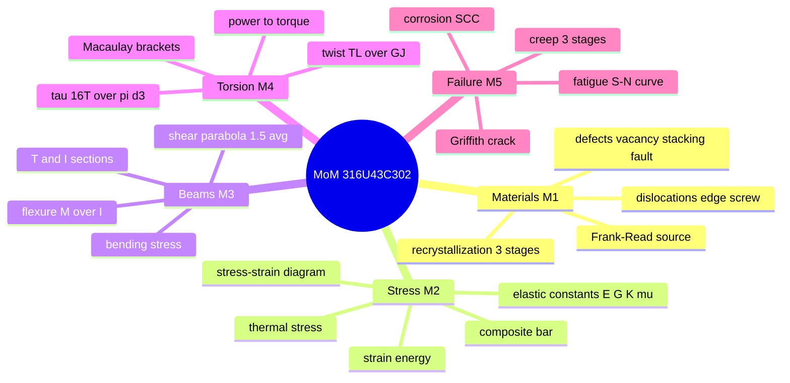

---

# MODULE 1 — Materials & Deformation (theory goldmine)

## 1.1 Classification of materials

| Class | Structure | Properties | Examples |
|---|---|---|---|
| Metals | crystalline | conduct, ductile, strong | steel, Al, Cu |
| Ceramics | crystalline ionic/covalent | hard, brittle, high-temp | alumina, SiC |
| Polymers | long chains | light, insulator, low strength | nylon, PMMA |
| Composites | matrix + reinforcement | high stiffness-to-weight | CFRP, GFRP |

**Composites in robotics (RAI hook):** arm links (stiff + light), drone frames, grippers/end-effectors.

## 1.2 Point defects
- **Vacancy** — missing atom; drives diffusion & creep.
- **Interstitial** — extra atom squeezed in a gap; lattice strain → hardening.
- **Impurity/substitutional** — foreign atom on a site; solid-solution strengthening.
Form by thermal fluctuation; concentration rises exponentially with temperature.

## 1.3 Edge vs screw dislocation (learn the ⊥ / ∥ distinction)

| | Edge | Screw |
|---|---|---|
| Geometry | extra half-plane of atoms | lattice spirals around line |
| Burgers vector | **⊥ dislocation line** | **∥ dislocation line** |
| Motion | slips ⊥ to b | motion ⊥ line... (cross-slip easy) |

**Why dislocations matter:** slip happens by dislocation MOTION, not whole-plane breaking → real yield ≪ theoretical. **Frank-Read source:** a pinned dislocation segment bows under stress, pinches off a loop, and repeats — multiplies dislocations → explains strain hardening.

## 1.4 Surface defects
- **Grain boundary** — misoriented crystals meet; blocks dislocations → **fine grain = stronger (Hall-Petch)**.
- **Sub-boundary** — low-angle wall of dislocations.
- **Stacking fault (ND25 short note)** — interruption of packing sequence (FCC ABCABC → …ABC|ABAB…, a local HCP-like slip); low energy in FCC; affects work hardening & SF energy determines deformation mode.

## 1.5 Single vs polycrystal deformation
Single crystal slips on **densest planes in densest directions** (FCC: {111}⟨110⟩). **Schmid's law: τ_R = σ cosφ cosλ** (resolved shear = axial stress × Schmid factor; max 0.5 at 45°).
Polycrystal: grains constrain each other; boundaries block slip → finer grains → higher yield.

## 1.6 Strain hardening
Dislocation density ↑ with strain → tangles (Lomer-Cottrell locks) block motion → stress must rise (the rising part of σ–ε curve). Removed by recrystallization annealing.

## 1.7 Recrystallization annealing — the 3 stages
Cold-worked metal heated to 0.3–0.5 T_m:
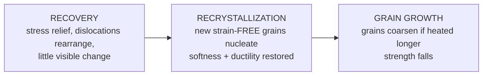
Factors: % cold work, temperature, time, purity.

## 1.8 Short-note bank (the Q1 factory)
**Schottky defect** = cation+anion vacancy PAIR in ionic crystal · **APF**: FCC 0.74, HCP 0.74, BCC 0.68, SC 0.52 · **ductility** = % elongation or % reduction in area · **endurance limit** = stress below which infinite life (~10⁶ cycles, ferrous) · **creep** = time-dependent strain under constant stress at high T.

---

# MODULE 2 — Stress, Strain, Deformation

## 2.1 The stress-strain diagram — walk it in order

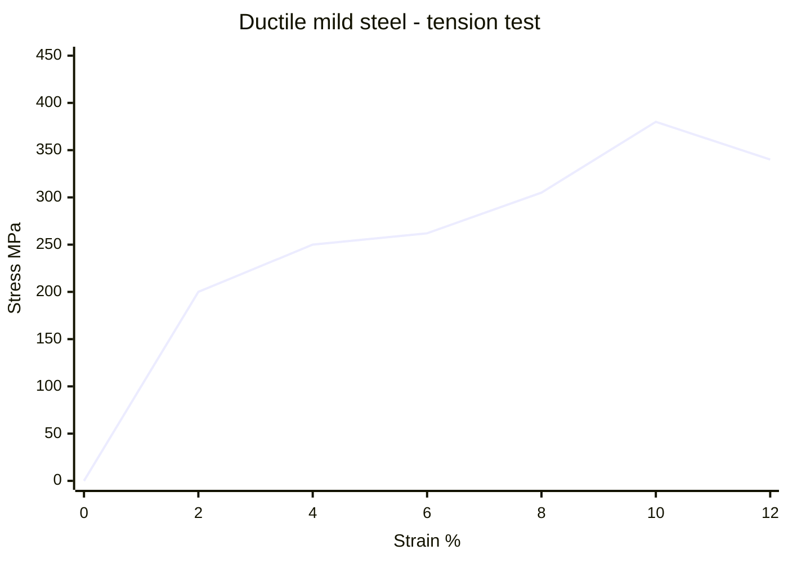

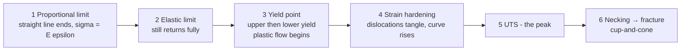
Labels to write on your exam sketch: proportional limit, elastic limit, upper/lower yield, UTS, fracture, elastic vs plastic zone.

## 2.2 Elastic constants — the triangle
**E = 2G(1+μ) = 3K(1−2μ).** Given any two → find the rest.
**E–G derivation (KT25 asked):** pure shear τ equals biaxial σ=τ tension+compression at 45°; shear strain γ = τ/G from direct definition; from the normal-strain rotation geometry γ = 2τ(1+μ)/E → equate → **G = E/2(1+μ)**.
**Hooke's law** σ = Eε · **FoS** = ultimate ÷ working stress · **μ** = −lateral/axial strain (metals 0.25–0.35; 0.5 = incompressible, rubber).

## 2.3 Axial + strain energy numericals
- Elongation: **δ = PL/AE**; stress σ = P/A; strain ε = δ/L.
- Strain energy (gradual load): **U = P²L/2AE = σ²V/2E**.
- **Sudden load:** stress ×2, deflection ×2, energy ×4 vs gradual.
- Diameter +10% at fixed P → U × 1/1.1² ≈ **−17.4%** (Dec20 asked exactly this).

## 2.4 Composite bar — method + verified numbers

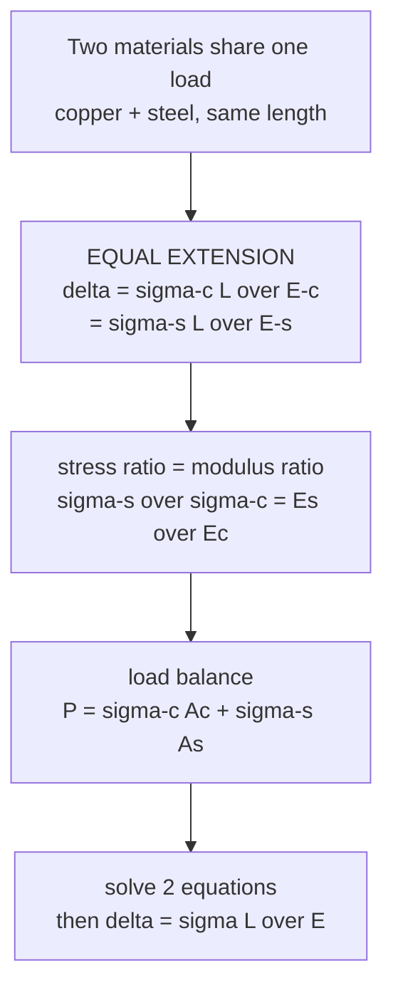
**Worked (ND25 type, verified):** Cu Ø25 (E=100 GPa) + steel Ø20 (E=200 GPa), L=1.5 m, P=25 kN → σc = **22.3 MPa**, σs = **44.7 MPa**, δ = **0.335 mm**.

## 2.5 Thermal stress — the trick-free formula
Rod fixed BOTH ends, temperature rise ΔT: free expansion αLΔT is blocked → **σ = EαΔT** — independent of length and area!
If supports yield by δ_s: effective blocked expansion = αLΔT − δ_s → σ = E(αLΔT − δ_s)/L.
**Worked (verified):** steel Ø30, L=4 m, ΔT=60, α=12×10⁻⁶, E=210 GPa → free expansion 2.88 mm, σ = **151.2 MPa**; supports yield 0.5 mm → σ = **124.9 MPa**.

## 2.6 Volumetric strain & eccentric loading
- e_v = εx+εy+εz; axial loading: e_v = ε(1−2μ).
- Eccentric load: **σ = P/A ± Pe·y/I** — compression + bending combined; corner with same sign as eccentricity gets max.
- **No-tension condition (core/limit of eccentricity):** rectangle e ≤ S/6 (**middle third**); circle e ≤ d/8 (**middle quarter**).

---

# MODULE 3 — Stresses in Beams

## 3.1 Max BM formulas (gateway to every bending numerical)

| Beam + load | M_max |
|---|---|
| Simply supported + central point W | WL/4 |
| Simply supported + UDL w | wL²/8 |
| Cantilever + end point W | WL |
| Cantilever + UDL w | wL²/2 |

SFD/BMD shapes (they ask "explain with figures"): SS+UDL → SF linear (+wL/2 → −wL/2, zero at midspan), BM parabolic max at mid. Cantilever+UDL → SF linear, BM parabolic max at fixed end (negative).

## 3.2 Bending stress — full worked pattern (ND25 exact type)

**Flexure formula: M/I = σ/y = E/R.** σ_max = M·y_max/I = M/Z where Z = I/y_max.
- Rectangle: I = bh³/12, Z = bh²/6 · Circle: I = πd⁴/64, **Z = πd³/32**.
- T-section: split into rectangles, find ȳ (centroid) then I by **parallel axis theorem** (I = I_self + A·d²).

**Worked (ND25 type, verified):** SS beam 5 m, UDL 10 kN/m, section 150 wide × 300 deep → M = wL²/8 = 31.25 kN·m; I = 150×300³/12 = 3.375×10⁸ mm⁴; σ_max = 31.25×10⁶ × 150 / 3.375×10⁸ = **13.89 MPa**; Z = 2.25×10⁶ mm³ (check: M/Z = same).
**Safe-load variant:** W = σ_allow·Z/L ×4 for central point load (since M = WL/4).

## 3.3 Flexure formula DERIVATION (4 moves — ND25 short)
1. Pure bending: **plane sections remain plane** (beam bends into circular arcs).
2. Strain ∝ distance from neutral axis: ε = y/R.
3. Hooke: σ = E·y/R — stress varies LINEARLY through depth.
4. Equilibrium: ∫σ dA = 0 → NA passes through CENTROID; ∫σ·y dA = M → **M/I = E/R = σ/y**.

## 3.4 Shear stress distribution
**τ = V·A·ȳ/(I·b)** — parabolic through depth, zero at outer fibres, max at NA.

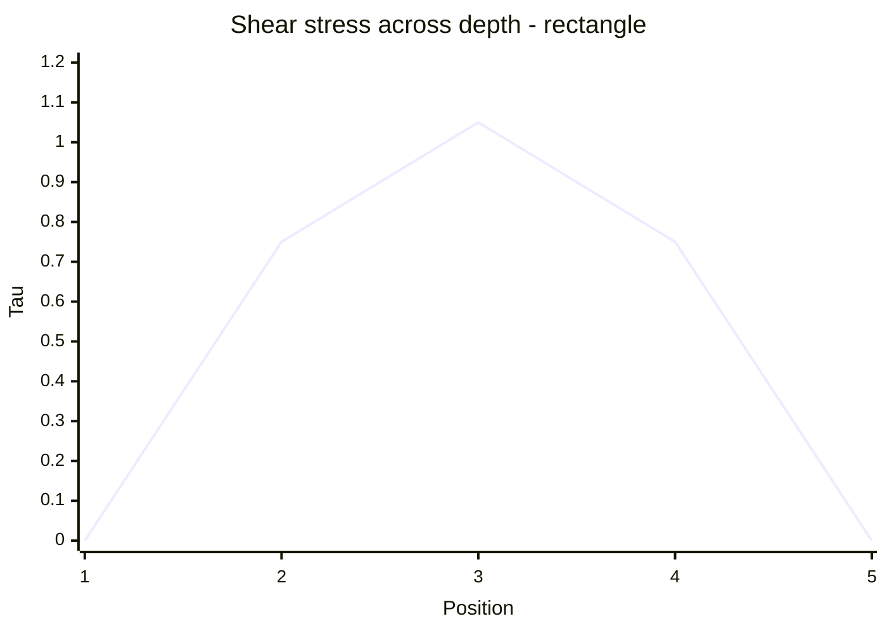
**Rectangle: τ_max = 1.5 × V/A · Circle: 4/3 × V/A.**
Worked (verified): 100×200 rect, V = 14 kN → τ_max = 1.5×14000/20000 = **1.05 MPa**.
I-section: τ jumps at flange-web junction (b changes from B to t_web); NA shear ≈ V/(t_web·h) × correction — compute by formula with local Aȳ.

## 3.5 T-section / combined sections — the verified worked example
T-section: flange 80×10 + web 70×10 (ND21 family): ȳ = **67.8 mm** from top, I about NA = **3.14×10⁶ mm⁴** (verified). Method: (1) areas + centroid; (2) parallel-axis each part; (3) σ = M·y/I at extreme fibres (both sides — different y!).

---

# MODULE 4 — Torsion + Deflection

## 4.1 The torsion pipeline (every numerical walks this)

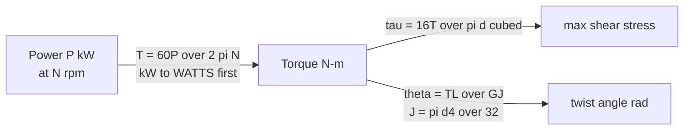
**T/J = τ/r = Gθ/L** — the torsion cousin of flexure. Zp = πd³/16 (solid).

**Worked (verified):** 30 kW @ 200 rpm, d = 60 mm, L = 2 m, G = 84 GPa → T = **1432.4 N·m**; τ = **33.8 MPa**; θ = 0.0268 rad = **1.54°**.
**Hollow-shaft variant:** J = π(D⁴−d⁴)/32. Dec20 type: P = 300 kW, 180 rpm, T_max = 1.25 T_mean → T_mean = 60P/2πN, check τ with 1.25×.
**Power-capacity variant (verified):** hollow 200 OD, 25 thick, 200 rpm, 0.5°/2 m limit → **277.6 kW**.

## 4.2 Hollow vs solid (the theory short)
J ∝ r⁴ measured from axis — central material contributes almost nothing. **Same strength → hollow weighs ~half; same weight → hollow is stiffer/stronger.** Quote: "drive shafts are tubes."

## 4.3 Compound shaft + pure-torsion principal stresses
- Steel+aluminium in series with torques: twist of each section shares the SAME T; total θ = Σ T·L/(GJ); permissible T₀ = min over each section's τ-limit: T_i = τ_allow·Zp,i.
- **Pure torsion ⇒ σ₁,₂ = ±τ at 45°** (Mohr circle centred at origin, radius τ). ND21: "40 MPa shear → principal = ±40 MPa, at 45°."

## 4.4 Macaulay's method — the 5-step algorithm (ND25 Q4)

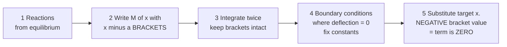
Worked frame: SS beam + central W: **δ_mid = WL³/48EI, θ_ends = WL²/16EI** · Cantilever + UDL: **δ = wL⁴/8EI, θ = wL³/6EI** · Cantilever + end couple: **θ = ML/EI, δ = ML²/2EI**.
**The "find W" twist (ND25):** given allowable δ → W = 48EIδ/L³ (central-load case).

---

# MODULE 5 — Failure (the guaranteed theory 10-marker)

## 5.1 Fatigue + S-N curve (ND25 exact)

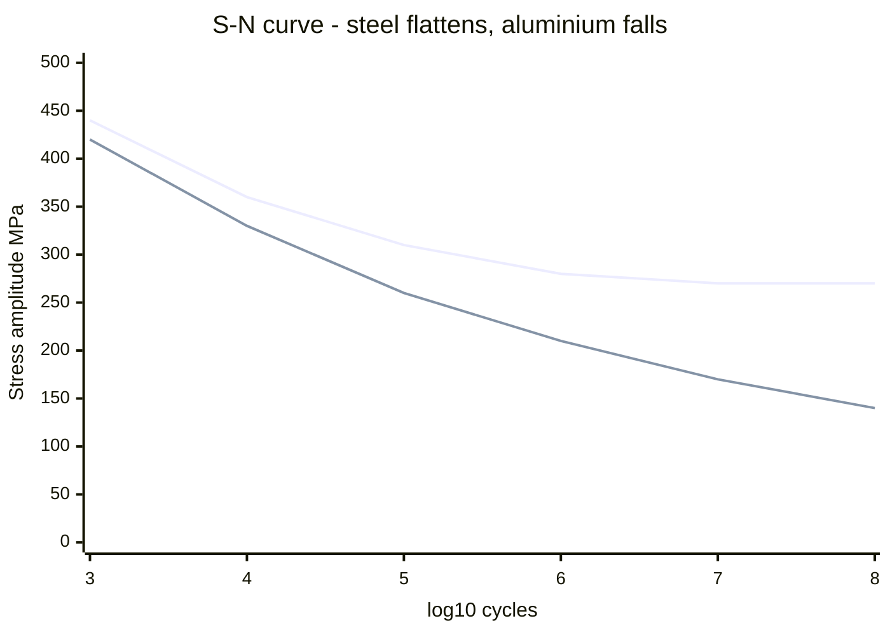

**Full-marks answer skeleton:**
- Definition: failure BELOW yield under REPEATED/cyclic loading.
- Stages: crack INITIATION (surface, stress concentrations, notches) → PROPAGATION (growth each cycle, beach marks) → FINAL fast fracture.
- Testing: rotating-beam (Wöhler) — specimen in bending rotated → fully reversed stress; plot S vs log N.
- Steel: endurance limit ≈ 0.5 UTS (infinite life below). Aluminium: NO endurance limit — finite life at any stress.
- Factors: surface finish, size, temperature, stress concentration, residual stress, mean stress.

## 5.2 Creep — 3 stages
Time-dependent inelastic strain at constant stress, significant above **0.4 T_m**.

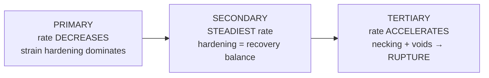
Creep-resistant: high melting point, coarse grains, dispersed precipitates — superalloys, Mo alloys.

## 5.3 Griffith's theory (+Orowan)
Brittle solids contain pre-existing cracks of length 2a. Crack grows when elastic-energy release ≥ surface energy of new crack faces:
**σ_f = √(2Eγ_s/πa)** (thin plate). **Orowan:** plastic work at the tip dwarfs surface energy (γ_p ≫ γ_s) → σ_f = √(2E(γ_s+γ_p)/πa).
Read it as: longer crack → lower failure stress; that's why inspection matters.

## 5.4 Ductile fracture + DBTT
Ductile: void nucleation → growth → coalescence → cup-cone fracture. Notch effect: triaxial stress state embrittles. **Ductile–brittle transition (DBTT):** low temperature + high strain rate + notch → brittle (Liberty ships!). Fracture toughness = resistance to crack propagation (K_IC).

## 5.5 Corrosion + SCC (ND25 Q1)
Types: uniform, galvanic (dissimilar metals), pitting, crevice, intergranular (weld decay), **stress-corrosion cracking**.
**SCC needs ALL THREE:** susceptible material + specific corrosive environment + sustained TENSILE stress (brass–ammonia, SS–chlorides). Prevention: coatings, inhibitors, cathodic protection, material selection, stress relief.

---

# THE NIGHT-BEFORE CHECKLIST

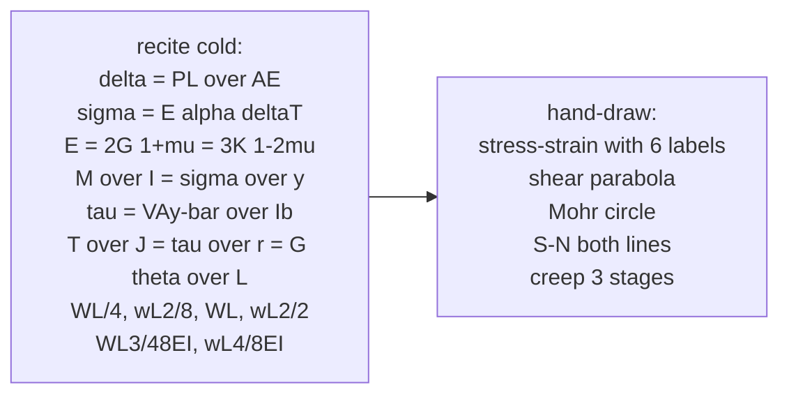

**Priority order from paper analysis:** (1) Mohr's circle 10-marker, (2) Macaulay with find-W twist, (3) bending stress with section, (4) torsion power problem, (5) composite/thermal bar, (6) fatigue+S-N full theory.
