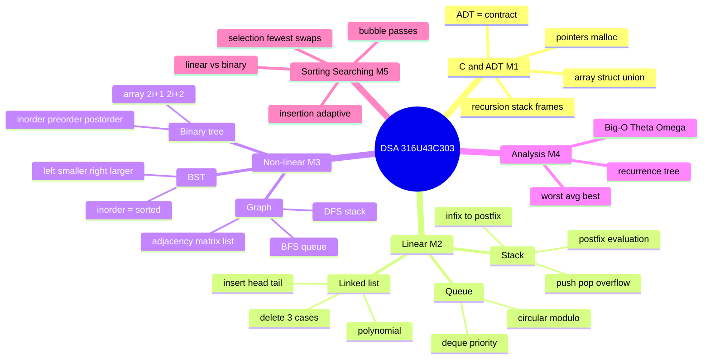
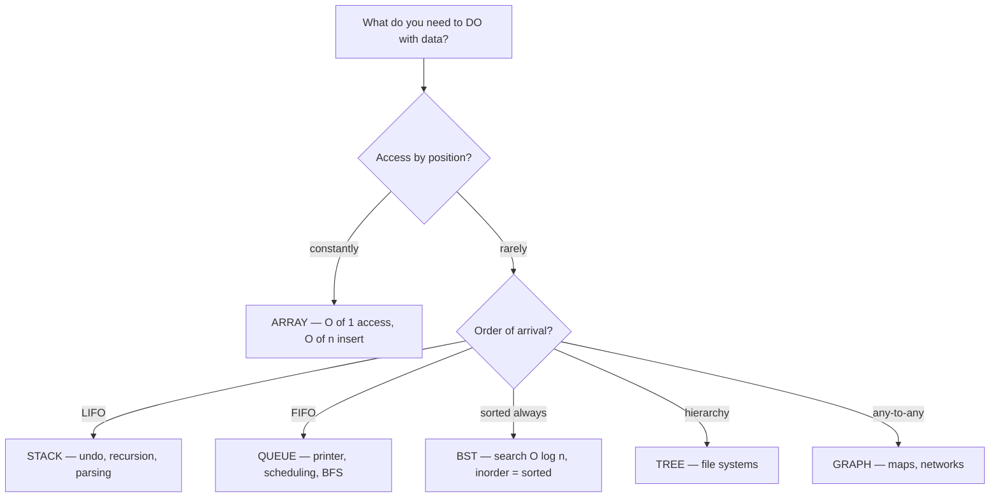
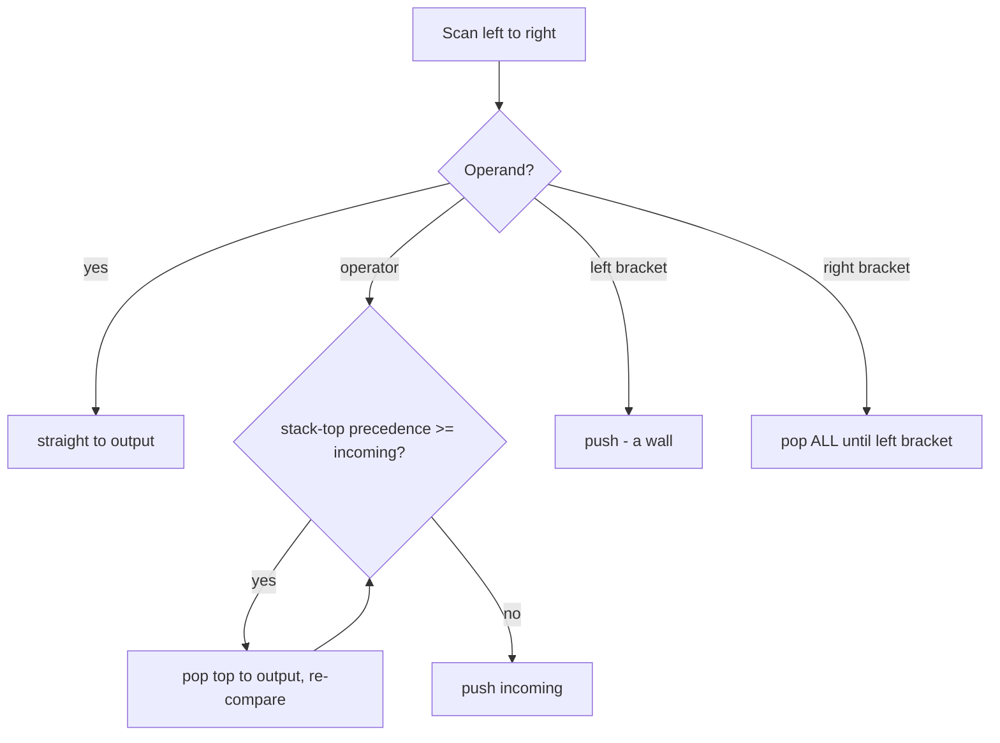
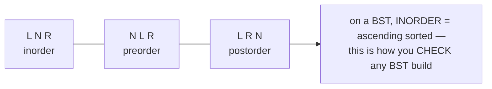
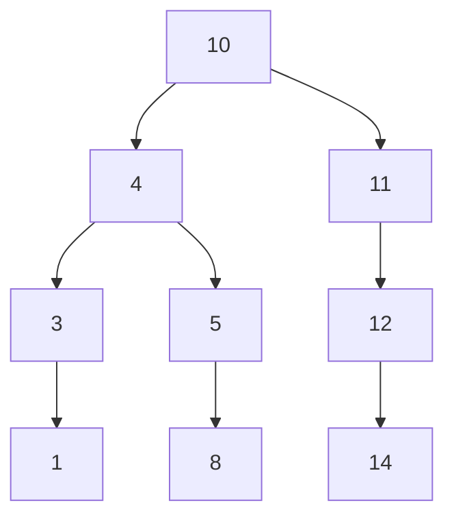
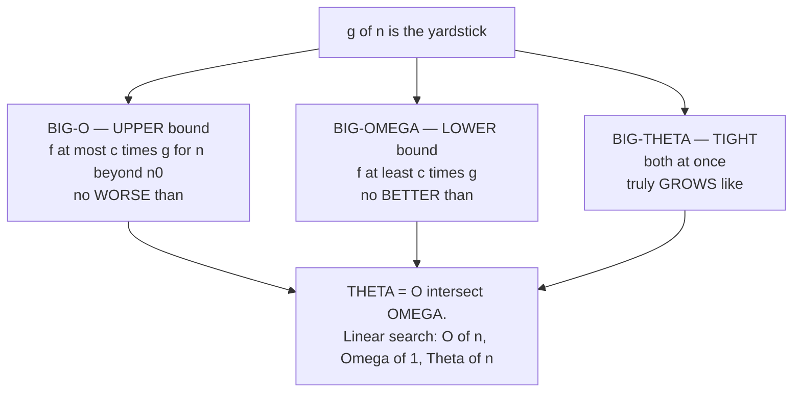
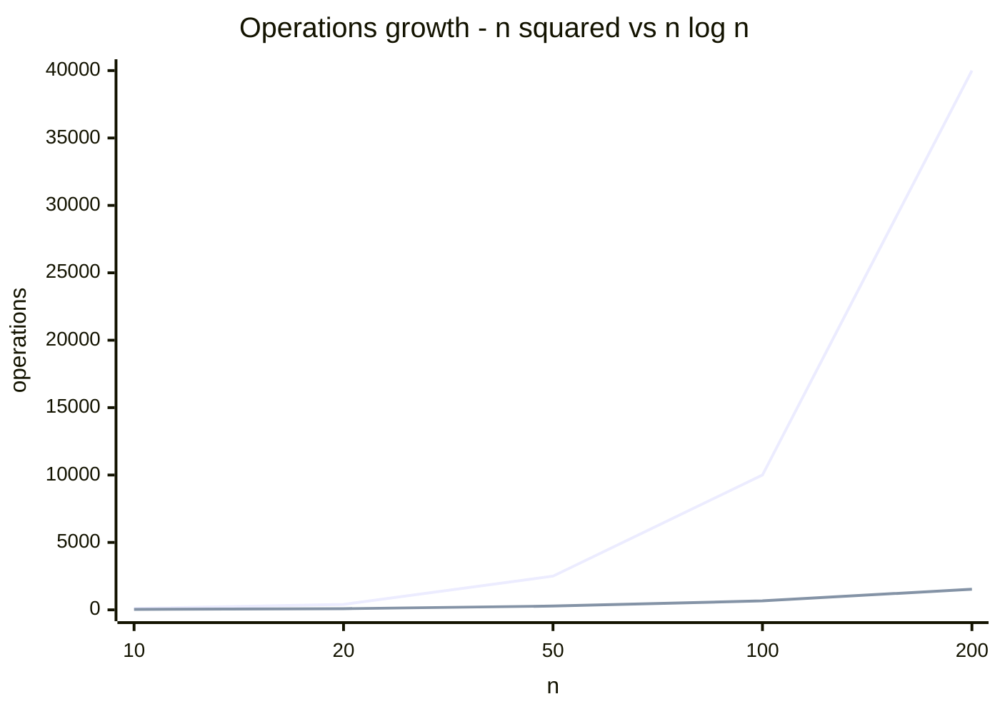
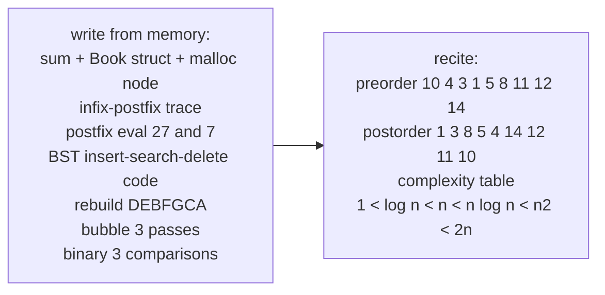

# DSA — The Complete Visual Study Guide
*Data Structures & Algorithms (316U43C303) · everything you must go over, in one file*
*Built from: RAI MJ25 real paper + 6 sister papers + syllabus mining + code-verified traces*

**How to use:** this is the WHOLE subject. Diagrams give you the shape; the text under each is the full answer matter. If it's here, it's because paper analysis says it pays marks.

---

## 0 · THE SUBJECT IN ONE PICTURE



**Exam shape:** 50 marks · Q1 any-two×5 · Q2 any-one×10 · Q3 any-one×10 · Q4/Q5 mixed. MJ25 asked for actual C code in 4 of 5 questions — WRITE code while revising, don't just read.

**Skip list (COMP/EXTC topics NOT in RAI syllabus):** hashing, AVL rotations, MST, Dijkstra, heaps, B-trees.

---

# MODULE 1 — C Foundations + ADT

## 1.1 Array — definition + the MJ25 code

**Definition:** contiguous same-type elements, fixed size, O(1) index access (address = base + i×sizeof(type)).

```c
// MJ25 Q1: sum of array elements
int sum(int a[], int n) {
    int s = 0;
    for (int i = 0; i < n; i++) s += a[i];
    return s;
}
```

## 1.2 Structure — the Book program (MJ25 exact)

```c
struct Book {
    char title[50], author[50];
    int  pages;
    float price;
};
void printBook(struct Book b) {
    printf("%s by %s, %d pages, Rs %.2f\n",
           b.title, b.author, b.pages, b.price);
}
int main() {
    struct Book b1 = {"DSA", "Reema Thareja", 500, 450.0};
    printBook(b1);
}
```

## 1.3 Array vs Structure vs Union (short-answer table)

| | Array | Structure | Union |
|---|---|---|---|
| Elements | same type | mixed types | mixed types |
| Memory | contiguous, one block | each member own block | ALL members SHARE one block |
| Size | n × element | sum of members | size of LARGEST member |
| Valid members | all | all | only ONE at a time |

## 1.4 Pointers + dynamic node creation (2021 MCQ)

```c
int x = 10, *p = &x;      // p holds ADDRESS of x
printf("%d", *p);          // * dereferences → 10

// the linked-list node creation pattern (know this cold):
struct Node { int data; struct Node *next; };
struct Node *ptr = (struct Node*) malloc(sizeof(struct Node));
```
**Traps they test:** cast the `void*` return; `sizeof(NODE)` not `sizeof(NODE*)`; check `ptr == NULL` in real code.

## 1.5 Recursion — and why the STACK makes it work

```c
long fact(int n) {
    if (n <= 1) return 1;          // BASE CASE — stops recursion
    return n * fact(n - 1);        // RECURSIVE CASE
}
```
Each call gets its own **stack frame** (parameters, locals, return address). Depth of recursion = pending frames. **No base case → stack overflow.** This is the "how does stack support recursion" answer.

## 1.6 ADT — the 5-mark definition (MJ25 asked verbatim)

**ADT = a logical contract: WHAT operations exist and HOW they behave, hiding HOW they're implemented.**
- Example: Stack ADT = push, pop, peek, isEmpty — implementable with an array OR a linked list.
- Significance: (1) abstraction — use without knowing internals, (2) implementation freedom — swap array for list, user code unchanged, (3) encapsulation — data safe behind operations.
- Exam phrasing: "ADT is defined by its operations and axioms, not by its storage."

## 1.7 Need for data structures + classification

Organise data around the OPERATIONS you need: fast search → BST; fast insert at front → linked list; undo → stack; scheduling → queue.
**Linear** (array, list, stack, queue) vs **non-linear** (tree, graph); **static** (array, fixed) vs **dynamic** (linked list, grows).
Real-life: playlist (list), browser back (stack), printer queue (queue), org chart (tree), metro map (graph).



---

# MODULE 2 — Stack, Queue, Linked List

## 2.1 Stack ADT — operations + conditions

**LIFO.** Operations: push, pop, peek(top), isEmpty. Array implementation: `top` index, init −1.

```c
#define MAX 5
int stack[MAX], top = -1;
void push(int v) {
    if (top == MAX - 1) { printf("OVERFLOW"); return; }
    stack[++top] = v;               // move top FIRST, then write
}
int pop() {
    if (top == -1) { printf("UNDERFLOW"); return -1; }
    return stack[top--];             // read FIRST, then move top
}
```
- **Overflow:** push when top == MAX−1 (array full) or heap exhausted (linked).
- **Memory management point (MJ25):** contiguous array → size fixed at compile time → overflow risk; linked implementation → grows on demand but per-node overhead.
- **Applications (write any 4):** string reverse, undo/redo (two stacks), expression conversion & evaluation, recursion, parenthesis matching, browser history.

## 2.2 Infix → Postfix — ALGORITHM (the classic 10-marker, 2021×2)

**Algorithm (write these steps in the exam):**
1. Scan the infix expression left to right.
2. **Operand** → append directly to output.
3. **'('** → push onto stack.
4. **')'** → pop and output until '(' appears; discard both brackets.
5. **Operator** → while stack top is an operator with precedence **≥** incoming (for left-associative), pop it to output; then push incoming. (For right-associative `^`, pop only while strictly greater.)
6. **End of input** → pop everything to output.

**Precedence:** `^` (3, right-assoc) > `* /` (2) > `+ −` (1).



**Full trace table — (a+b*c)/(d−e) → a b c * + d e − / (verified by code):**

| Symbol | Action | Stack | Output |
|---|---|---|---|
| a | operand → out | | a |
| + | push | + | a |
| b | out | + | a b |
| * | * > + → push | + * | a b |
| c | out | + * | a b c |
| ) | pop to '(' | | a b c * + |
| / | stack empty → push | / | a b c * + |
| d | out | / | a b c * + d |
| − | / ≥ − → pop /, then push − | − | a b c * + d / |
| e | out | − | a b c * + d / e |
| end | pop all | | **a b c * + d e − /** |

## 2.3 Postfix evaluation — ALGORITHM + trace

1. Scan left to right. 2. **Operand** → push. 3. **Operator** → pop TWO (second-popped is the LEFT operand), compute, push result. 4. End → stack top is the answer.

**Trace 6 3 2 + * 4 2 / + 5 − = 27 (verified):**

| Token | Stack after |
|---|---|
| 6 3 2 | [6, 3, 2] |
| + | [6, 5] (3+2) |
| * | [30] (6×5) |
| 4 2 | [30, 4, 2] |
| / | [30, 2] (4/2) |
| + | [32] |
| 5 | [32, 5] |
| − | **[27]** |

Second exam trace: `6 2 3 + − 3 8 2 / + *` = **7** (verified by code).

## 2.4 Queue ADT + why CIRCULAR exists

**FIFO.** Operations: enqueue(rear), dequeue(front). 
**The drawback of the linear array queue (write exactly this):** after dequeues, front moves forward; cells BEFORE front are unreachable; rear hits MAX−1 while cells lie empty → **false overflow**.
**Circular queue fixes it** with modulo wraparound:

```c
rear = (rear + 1) % MAX;          // enqueue
front = (front + 1) % MAX;        // dequeue
// FULL:  (rear + 1) % MAX == front
// EMPTY: front == -1
```
**Types (one line each):** circular (wraparound), deque (insert+delete both ends), priority (served by priority, not arrival).
**Applications:** printer spooling, CPU ready-queue scheduling, keyboard buffer, BFS traversal, **job sequencing** (syllabus-named — jobs wait in queue for a shared resource).

## 2.5 Singly Linked List — ALGORITHMS + C code (MJ25 10-marker)

**Node:** `struct Node { int data; struct Node *next; };` — data + pointer, scattered in heap memory.

**Insert at BEGINNING — O(1):**
```
ALGORITHM INSERT_BEG(head, value)
1. n ← new Node
2. n.data ← value
3. n.next ← head      // new node points to old first
4. head ← n           // head now points to new node
```
```c
void insBeg(struct Node **head, int v) {
    struct Node *n = malloc(sizeof(struct Node));
    n->data = v;
    n->next = *head;
    *head = n;
}
```

**Insert at END — O(n) without a tail pointer:**
```
ALGORITHM INSERT_END(head, value)
1. n ← new Node; n.data ← value; n.next ← NULL
2. IF head == NULL: head ← n; RETURN
3. t ← head
4. WHILE t.next ≠ NULL: t ← t.next     // walk to last node
5. t.next ← n
```
```c
void insEnd(struct Node **head, int v) {
    struct Node *n = malloc(sizeof(struct Node)), *t = *head;
    n->data = v; n->next = NULL;
    if (!*head) { *head = n; return; }
    while (t->next) t = t->next;
    t->next = n;
}
```

**Deletion — 3 cases:**
```
ALGORITHM DELETE(head, key)
CASE 1 key at head:   head ← head.next; free old head
CASE 2 in middle:     predecessor.next ← target.next; free target
CASE 3 at tail:       same as case 2 (predecessor.next ← NULL)
(all need locating the PREDECESSOR — walk with prev/cur pair)
```

**Array vs linked list (the table):**

| | Array | Linked list |
|---|---|---|
| Memory | contiguous, fixed | scattered heap nodes, grows |
| Access i-th | O(1) | O(n) |
| Insert/delete at front | O(n) shift | **O(1)** |
| Extra memory | none | pointer per node |
| SLL vs DLL | one direction | prev+next, 2× pointers, easier deletion |

**Polynomial via SLL (ND21):** node = (coeff, power, next); store terms by DESCENDING power; addition = merge two sorted lists, ADD coefficients when powers match.

---

# MODULE 3 — Trees & Graphs

## 3.1 Terminology + types

**Root** (no parent), **leaf** (no children), **degree** = children count, **siblings** = same parent, **depth** = nodes on longest root→leaf path (MJ21 MCQ), **height** = levels.
**Full** binary tree: every node has 0 or 2 children. **Complete:** all levels filled except possibly last, filled left-to-right. **Skewed:** every node one child — degenerates to a list.

```c
struct tnode { int data; struct tnode *left, *right; };
```
**Array representation (0-indexed):** node i → children at **2i+1 and 2i+2**, parent at (i−1)/2. Wastes space for sparse/skewed trees.

## 3.2 Traversals — pseudocode (MJ25 asked inorder)

```
INORDER(t):    if t ≠ NULL: INORDER(t.left);  visit(t);  INORDER(t.right)   // L N R
PREORDER(t):   if t ≠ NULL: visit(t);  PREORDER(t.left);  PREORDER(t.right) // N L R
POSTORDER(t):  if t ≠ NULL: POSTORDER(t.left); POSTORDER(t.right); visit(t) // L R N
```


## 3.3 Rebuild tree from inorder + preorder (COMP ND25 — likely for RAI)

**Algorithm:** 1. preorder[0] = root. 2. Locate it in inorder. 3. Elements LEFT of it = left subtree; RIGHT = right subtree. 4. Recurse with the shortened arrays.

**Worked (verified):** preorder **A B D E C F G**, inorder **D B E A F C G**
- Root = A. Inorder splits: (D B E) | A | (F C G)
- Left subtree preorder B D E → root B; inorder (D|B|E) → D left, E right
- Right subtree preorder C F G → root C; inorder (F|C|G) → F left, G right
- → postorder = **D E B F G C A**

## 3.4 BST — THE core topic (MJ25 + ND21 + EXTC ND25 all hit it)

**Definition/property:** for every node — ALL keys in left subtree < node < ALL keys in right subtree. Inorder traversal yields ASCENDING order.


*(the ND21 exam tree, built below)*

**INSERT — algorithm:**
```
ALGORITHM BST_INSERT(t, key)
1. IF t == NULL: return new Node(key)
2. IF key < t.data:  t.left  ← BST_INSERT(t.left,  key)
3. ELSE IF key > t.data: t.right ← BST_INSERT(t.right, key)
4. (equal → ignore/duplicate policy)
5. return t
```
```c
struct tnode* insert(struct tnode *t, int key) {
    if (t == NULL) {
        t = malloc(sizeof(struct tnode));
        t->data = key; t->left = t->right = NULL;
        return t;
    }
    if (key < t->data)      t->left  = insert(t->left,  key);
    else if (key > t->data) t->right = insert(t->right, key);
    return t;
}
```

**SEARCH — algorithm:**
```
ALGORITHM BST_SEARCH(t, key)
1. IF t == NULL: NOT FOUND
2. IF key == t.data: FOUND
3. IF key < t.data: search t.left  ELSE: search t.right
```
Each comparison discards HALF the tree → O(h); h = log₂(n+1)−1 balanced, n worst (skewed).

**DELETE — the 3 cases (know all three):**
```
ALGORITHM BST_DELETE(t, key)
Find node (as in search). Then:
CASE 1 — leaf:                free it; parent's pointer ← NULL
CASE 2 — one child:           splice: parent's pointer ← the single child; free node
CASE 3 — two children:        replace node's data with INORDER SUCCESSOR
                              (minimum of right subtree = leftmost node there);
                              delete that successor (it has ≤1 child → case 1/2)
```
```c
struct tnode* del(struct tnode *t, int key) {
    if (!t) return NULL;
    if (key < t->data)      t->left  = del(t->left,  key);
    else if (key > t->data) t->right = del(t->right, key);
    else {                                  // found
        if (!t->left)              { struct tnode *r = t->right; free(t); return r; }
        if (!t->right)             { struct tnode *l = t->left;  free(t); return l; }
        struct tnode *s = t->right;         // inorder successor:
        while (s->left) s = s->left;        // leftmost of right subtree
        t->data = s->data;
        t->right = del(t->right, s->data);  // delete the successor
    }
    return t;
}
```

**Construction trace — insert 10,4,3,5,11,12,14,8,1 (ND21, verified by code):**
10 root · 4<10 left · 3<4 left · 5 (4<10→left; >4→right of 4) · 11>10 right · 12>10,>11 · 14 right-most · 8 (left of 10; right of 4; right of 5) · 1 left-most.
→ **preorder 10 4 3 1 5 8 11 12 14 · postorder 1 3 8 5 4 14 12 11 10** · inorder = the sorted input.

**Applications (write 2):** dynamic sorted collections (insert+search together), in-memory maps/sets/dictionaries, range queries (keys between L and H).

## 3.5 Graphs

**G = (V, E).** **Directed** (arcs one-way — Twitter follows) vs **undirected** (two-way — roads). Types: weighted (costs on edges), complete (all pairs joined — n(n−1)/2 edges), cyclic/acyclic, connected.

**Representations:**
| | Adjacency MATRIX | Adjacency LIST |
|---|---|---|
| Space | O(V²) | O(V+E) |
| Edge check | O(1) | O(degree) |
| Good for | DENSE graphs | SPARSE graphs (usual case — 2021 MCQ) |

**DFS — algorithm (MJ25 asked "explain how DFS works"):**
```
ALGORITHM DFS(v)
1. Mark v visited; visit(v)
2. FOR each neighbour w of v:
3.     IF w not visited: DFS(w)          // recursion = the stack
```
Goes DEEP along one path, backtracks at dead ends. Uses a STACK (explicit or recursion).

**BFS — algorithm (ND21 asked full):**
```
ALGORITHM BFS(start)
1. Mark start visited; ENQUEUE(start)
2. WHILE queue not empty:
3.     v ← DEQUEUE; visit(v)
4.     FOR each neighbour w of v: IF not visited: mark, ENQUEUE(w)
```
Explores LEVEL by level. Uses a QUEUE. **Gives shortest path in unweighted graphs** (RAI self-learning hook).

| | DFS | BFS |
|---|---|---|
| Data structure | stack/recursion | queue |
| Pattern | deep, backtrack | level by level |
| Applications | cycle detection, topological sort | shortest path (unweighted), level order |
| Complexity | O(V+E) list | O(V+E) list |

Both need a visited[] array — cycles would loop forever without it.

---

# MODULE 4 — Analysis of Algorithms

## 4.1 What makes a good algorithm
Correct + finite + efficient (time AND space). **Time complexity** = number of primitive operations as a function of input size n. **Space complexity** = extra memory consumed. Both matter — robotics/embedded is memory-constrained.

## 4.2 The Big-O / Θ / Ω trio (MJ25 asked how they relate)


**Formal (write for full marks):** f(n) = O(g(n)) iff ∃ c>0, n₀ such that f(n) ≤ c·g(n) ∀ n ≥ n₀. (Ω: ≥; Θ: both.)

## 4.3 Worst / average / best — and how to DETERMINE (MJ25)
Determined by INPUT ARRANGEMENT, not the algorithm alone:
- **Linear search:** worst = last element/absent → n comparisons; best = first → 1; average ≈ (n+1)/2.
- **Binary search:** worst log n; best 1.
- **Bubble sort:** worst/avg O(n²); best (already sorted + early-exit flag) O(n).

## 4.4 Recurrence relations (MJ25 named both methods)

- **Substitution/unrolling:** T(n) = T(n−1) + c → T(n−1)+2c → … → n terms → **O(n)**.
- **Recursion tree:** T(n) = 2T(n/2) + n → each level's nodes sum to n cost; log₂n levels → n·log n → **O(n log n)**.
- **Master method (self-learning):** T(n) = aT(n/b) + f(n); compare f with n^(log_b a).

## 4.5 The chain to memorize cold
**1 < log n < √n < n < n log n < n² < n³ < 2ⁿ**
Asymptotic analysis = machine-independent growth-rate comparison; constants and lower terms dropped.

---

# MODULE 5 — Searching & Sorting

## 5.1 Linear search — code + analysis (MJ25)

```c
int linearSearch(int a[], int n, int key) {
    for (int i = 0; i < n; i++)
        if (a[i] == key) return i;
    return -1;
}
```
Works on UNSORTED data. O(n). Space O(1).

## 5.2 Binary search — algorithm + code + trace

**Requires SORTED input.** Compare middle; go left or right; halve each step.
```
ALGORITHM BINARY(a, low, high, key)
1. WHILE low ≤ high:
2.     mid ← (low + high) / 2
3.     IF a[mid] == key: RETURN mid
4.     ELSE IF key < a[mid]: high ← mid − 1
5.     ELSE: low ← mid + 1
6. RETURN not found
```
```c
int binSearch(int a[], int n, int key) {
    int lo = 0, hi = n - 1;
    while (lo <= hi) {
        int mid = (lo + hi) / 2;
        if (a[mid] == key) return mid;
        if (key < a[mid]) hi = mid - 1; else lo = mid + 1;
    }
    return -1;
}
```
**Trace (verified): find 29 in {7,12,29,38,45,51,77}:** mid 38 → 29<38 left · mid 12 → 29>12 right · mid 29 → FOUND. **3 comparisons.**
**Space (MJ25 asked exactly this):** iterative O(1); recursive O(log n) stack frames.

## 5.3 Bubble sort — algorithm + code + the exam trace

```
ALGORITHM BUBBLE(a, n)
1. FOR pass = 1 to n−1:
2.     FOR i = 0 to n−pass−1:
3.         IF a[i] > a[i+1]: swap            // largest bubbles to end
4.     (optimization: if NO swap in a pass → already sorted, STOP)
```
```c
void bubble(int a[], int n) {
    for (int pass = 0; pass < n - 1; pass++) {
        int swapped = 0;
        for (int i = 0; i < n - 1 - pass; i++)
            if (a[i] > a[i+1]) { int t=a[i]; a[i]=a[i+1]; a[i+1]=t; swapped=1; }
        if (!swapped) break;
    }
}
```
**Passes trace — {92,85,57,26} (EXTC ND25, memorize):** P1 {85,57,26,92} → P2 {57,26,85,92} → P3 {26,57,85,92}. Max n−1 passes; n(n−1)/2 comparisons worst.

## 5.4 Insertion sort — and WHEN it wins (MJ25 asked to synthesize)

```
ALGORITHM INSERTION(a, n)
1. FOR i = 1 to n−1:              // a[0..i−1] is the sorted prefix
2.     key ← a[i]
3.     j ← i − 1
4.     WHILE j ≥ 0 AND a[j] > key: a[j+1] ← a[j]; j−−   // shift right
5.     a[j+1] ← key
```
**Why best for nearly-sorted:** each element shifts only past LARGER elements — nearly sorted → ~1 shift each → **O(n) best case, ADAPTIVE**. Scenario to quote: "a daily-updated leaderboard re-sorted every morning — one new score enters an almost-sorted list."

## 5.5 Selection sort

```
ALGORITHM SELECTION(a, n)
1. FOR i = 0 to n−2:
2.     min ← i
3.     FOR j = i+1 to n−1: IF a[j] < a[min]: min ← j
4.     swap a[i], a[min]           // exactly ONE swap per pass
```
n−1 total swaps — fewest WRITES (good when writes are costly, e.g. flash).

## 5.6 Master comparison table (they ask for it directly)

| Algorithm | Best | Average | Worst | Space | Stable | When |
|---|---|---|---|---|---|---|
| Bubble | O(n)* | O(n²) | O(n²) | O(1) | Yes | small/teaching (*with flag) |
| Insertion | **O(n)** | O(n²) | O(n²) | O(1) | Yes | nearly-sorted, streams |
| Selection | O(n²) | O(n²) | O(n²) | O(1) | **No** | expensive writes |
| Linear search | O(1) | O(n) | O(n) | O(1) | — | unsorted data |
| Binary search | O(1) | O(log n) | O(log n) | O(1) iter / O(log n) rec | — | sorted data |



---

# THE NIGHT-BEFORE CHECKLIST



**Priority order from paper analysis:** (1) infix→postfix + postfix eval, (2) BST construct/insert/delete + traversal rebuild, (3) SLL insert/delete C code, (4) DFS/BFS on a drawn graph, (5) bubble passes, (6) complexity table + Big-O trio.
