# HPS — The Complete Visual Study Guide
*Hydraulic & Pneumatic Systems (316U43C304) · everything you must go over, in one file*
*Built from: TWO real RAI papers (MJ25 + ND25) + syllabus mining — highest repetition density of all 5 subjects*

**How to use:** Q4+Q5 = 20 marks of pure circuit-drawing EVERY year. For each circuit below: understand the logic diagram → then practise drawing it with real ISO symbols until your hand remembers. Every component list + working step sequence is here.

---

## 0 · THE SUBJECT IN ONE PICTURE + THE PAPER PATTERN

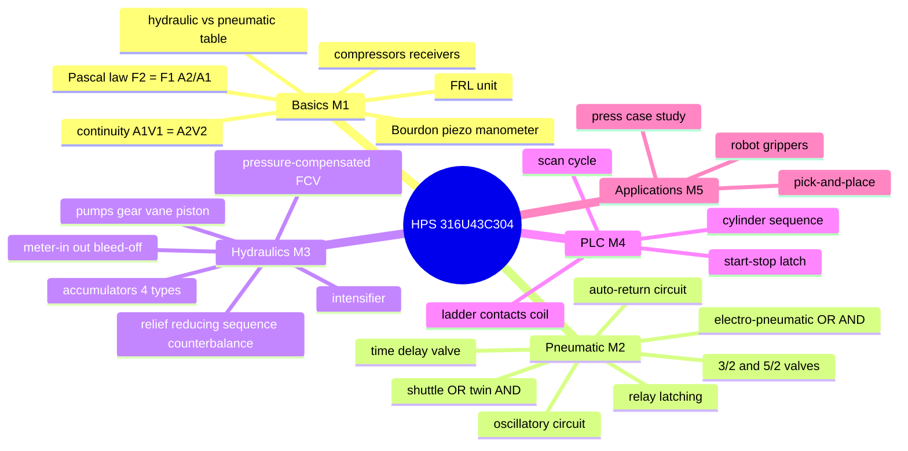

| Q | MJ25 asked | ND25 asked |
|---|---|---|
| Q1 (any 2×5) | Bourdon · lift force · continuity | Piezo sensor · Pascal + applications · hydraulic vs pneumatic |
| Q2 (any 1×10) | Accumulators · DCV types | Piston vs plunger pump · intensifiers |
| Q3 (any 1×10) | Counterbalance circuit · oil properties | Sequence valve circuit · pressure-comp FCV + meter-in |
| Q4 (5+5) | Oscillatory circuit · time-delay valve | Indirect control · shuttle valve |
| Q5 (5+5) | Relay · auto-return circuit | Power supply · OR-logic electro-pneumatic |

---

# MODULE 1 — Fluid Power Basics

## 1.1 Pascal's law + the lift numerical (asked in both papers)

**Law:** pressure applied to a confined fluid transmits EQUALLY in all directions (P = F/A).
**Lift:** F₂ = F₁(A₂/A₁) = F₁(D₂/D₁)².

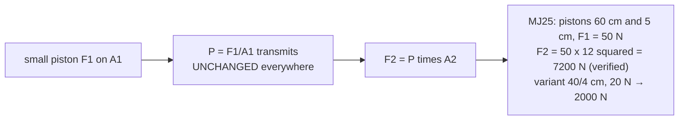
**Applications list (write 4):** hydraulic lift/jack/press/brakes, robotic grippers, material testing machines.

## 1.2 Continuity + Bernoulli ideas
**A₁V₁ = A₂V₂** (incompressible steady flow). Uses: pipe sizing, actuator speed from pump flow (**v = Q/A**), velocity in a narrowed section.

## 1.3 The generalized pneumatic system (draw this chain)

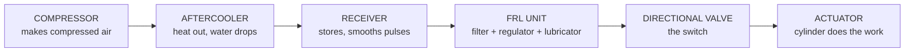

**FRL (classic short note):** **Filter** — coalescing element removes dust/moisture before air reaches valves · **Regulator** — drops line to working pressure and HOLDS it (with relief) · **Lubricator** — venturi adds oil mist for valve/cylinder life.

## 1.4 Compressors + receiver
**Reciprocating:** piston + inlet/discharge reed valves; down-stroke sucks (inlet opens), up-stroke compresses (discharge opens). Single/two-stage (intercooling between). **Rotary screw:** continuous, quiet, for constant demand. 
**Receiver:** stores energy, damps pulsation, lets moisture settle; sized ≈ (supply − demand) × time / allowed pressure drop.

## 1.5 Pressure measurement (one from each paper!)

| Device | Principle | Draw + label |
|---|---|---|
| **Bourdon tube (MJ25)** | oval C-tube straightens under internal pressure → linkage/gears → needle | tube + sector gear + link + pointer + dial |
| **Piezoelectric (ND25)** | quartz crystal charge ∝ pressure → amplifier | crystal + electrodes + readout |
| Diaphragm gauge | pressure deflects elastic diaphragm | diaphragm + transmission link |
| Manometer | liquid column: P = ρgh | U-tube + liquid levels |

## 1.6 Hydraulic vs pneumatic (ND25 — 100% must-prepare table)

| | Hydraulic | Pneumatic |
|---|---|---|
| Medium | oil (incompressible) | air (compressible) |
| Pressure | 70–350 bar | 2–10 bar |
| Force | very high | moderate |
| Speed | slower | very fast |
| Precision | high | lower (air squishes) |
| Leakage | messy oil | clean, exhausts to air |
| Fire safety | good | excellent (explosion zones) |
| Cost | higher | lower |
| Typical use | presses, heavy robots | packaging, grippers |

---

# MODULE 2 — Pneumatic & Electro-Pneumatic Circuits

## 2.1 Symbol vocabulary (ISO 1219) — learn cold
Single-acting cylinder (one port + spring return) · double-acting (two ports) · **3/2 valve** = 3 ports/2 positions (for single-acting) · **5/2 valve** = 5 ports/2 positions (double-acting) · one-way flow control (throttle + check) · shuttle (two inlets merge) · twin-pressure (AND block) · roller-lever actuation · solenoid actuation.

## 2.2 Direct control of single-acting cylinder
3/2 NC push-button valve between FRL and cylinder: press → extend; release → spring retracts. Components: supply → FRL → 3/2 PB → cylinder → exhaust.

## 2.3 The oscillatory circuit (MJ25 Q4 — auto-reciprocation)

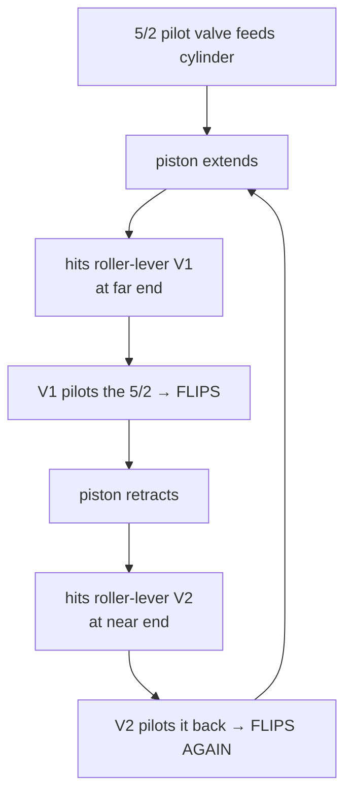
**Exam drawing:** double-acting cylinder, roller-lever limit valves at BOTH stroke ends, pilot lines to both pilot ports of the 5/2. **Working sentence:** "each end-of-stroke contact sends a pilot signal that reverses the main valve — the cylinder reciprocates continuously without operator action."

## 2.4 Indirect control (ND25 Q4)
Small 3/2 push-button sends a PILOT signal to the main 5/2 valve which switches the main flow. **Why:** signal valves are small; the main valve handles full power flow — small valve controls, big valve works. Components: FRL, 3/2 PB, 5/2 pilot DCV, double-acting cylinder.

## 2.5 Logic valves — OR and AND

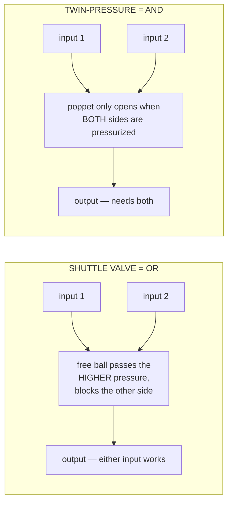
**Shuttle applications (ND25):** control a cylinder from either of two stations; safety interlock. **Exam wording:** "output = whichever signal is present; the ball seals the inactive port."

## 2.6 Time-delay valve (MJ25)
One-way FCV charging a small air reservoir → pressure builds slowly → piloted 3/2 switches after the set delay. **Symbol:** FCV + reservoir + pilot 3/2 combined. **Application:** dwell between two cylinder actions (press-hold-then-return), sequencing without PLC.

## 2.7 Solenoid valves + the relay (MJ25)

**Solenoid:** coil energizes → armature shifts spool. 3/2 single-solenoid (spring return); 5/2 double-solenoid (last-position memory).

**Relay — full answer:**
- Construction: coil + iron armature + NO/NC contacts.
- Working: energize coil → electromagnet pulls armature → contacts change over.
- **Advantages:** isolation (24 V control switching high power), amplification, multiple simultaneous contacts, latching ability.

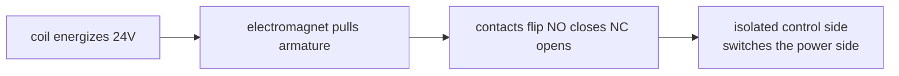

## 2.8 Electro-pneumatic circuits (the Q5 bank)

**Latching ladder (syllabus-named):**
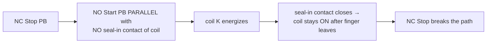

**Auto-return electro-pneumatic (MJ25 Q5):** PB → solenoid Y1 → extend → forward limit switch fires → Y2 → auto retract. Draw BOTH: electrical rung (PB, LS, Y1/Y2) + pneumatic side (5/2, cylinder).

**OR logic electro-pneumatic (ND25 Q5):** two NO PBs in **PARALLEL** → either energizes relay K1 → K1 contact drives solenoid → single-acting cylinder extends. **AND = same two in SERIES.**

**Power supply role (ND25 Q1):** converts 230 V AC mains → 24 V DC for solenoids/sensors; transformer isolation + rectifier + capacitor smoothing + fuse protection. 24 V DC is the electro-pneumatic standard.

---

# MODULE 3 — Hydraulics & Electro-Hydraulics

## 3.1 Hydraulic fluids (MJ25) — properties + additives
**Properties (write 6):** proper viscosity + high VI (stable across temperature), lubricity, oxidation resistance, demulsibility (sheds water), anti-foam, pour/flash point, seal compatibility.
**Types:** mineral (common), synthetic phosphate-ester (fire-resistant), water-glycol. **Selection:** pressure, temperature, fire risk.
**Additives:** VI improvers, anti-wear (ZDDP), anti-foam, antioxidants, rust inhibitors.
**Filter vs strainer:** fine (10 µm, pressure/return line) vs coarse mesh (~150 µm, pump inlet).

## 3.2 Pumps (ND25 asked piston vs plunger)

| Pump | Mechanism | Pressure | Notes |
|---|---|---|---|
| Gear | two meshing gears carry oil in tooth spaces | 20–200 bar | cheap, noisy, dirt-tolerant, fixed displacement |
| Vane | slotted rotor in cam ring | ~170 bar | quiet, can be pressure-compensated |
| **Piston (axial)** | rotating block + swash plate reciprocates pistons | 300+ bar | most efficient, costly — CONSTRUCTION + WORKING asked ND25 |
| Plunger | single plunger + seal | low | simple, lab use — the contrast ND25 wanted |

## 3.3 Accumulators (MJ25) + intensifiers (ND25)
**Accumulator functions:** energy reserve, damps pulsation, emergency power, leakage compensation. **Types:** weighted (constant pressure, huge), spring (low pressure), gas-charged — bladder (rubber bladder in shell — DRAW), diaphragm, piston.
**Intensifier:** large-area piston drives small-area piston → **P₂ = P₁(A₁/A₂)** — high pressure from a low-pressure source. Types: single-stage (air-to-oil), two-stage.

## 3.4 Directional control valves (MJ25)
4/3 closed-centre (blocks all — holds load), tandem (pump unloaded, cylinder held), open-centre. **Check valve** — free one-way. **Pilot-operated check** — free return only when pilot signal present (hold loads).

## 3.5 The four pressure valves — who does what

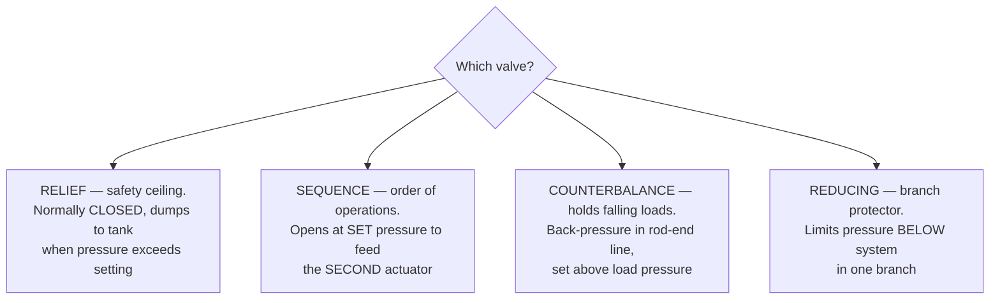

**Sequencing circuit (ND25 Q3) — working steps:**
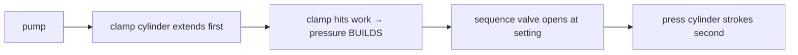
**Counterbalance (MJ25):** pressure-controlled check in the vertical cylinder's rod-end line, set slightly above load-induced pressure → prevents drifting/falling, gives smooth descent (presses, loaders, injection moulding).

## 3.6 Flow control + the three meter circuits

| Circuit | FCV position | Use |
|---|---|---|
| **Meter-in** | cylinder INLET | resistive loads |
| **Meter-out** | cylinder OUTLET | overrunning/negative loads, presses |
| **Bleed-off** | branch to tank | efficient, less stable speed |

**Pressure-compensated FCV (ND25):** internal compensator holds ΔP across the throttle CONSTANT → flow stays constant regardless of load pressure changes. Needle valve alone: flow varies with load.

## 3.7 Power pack
Reservoir + electric motor + pump + relief valve + filter + gauge + ( cooler ) — draw labelled box; it's the heart of every hydraulic circuit diagram.

---

# MODULE 4 — PLC

## 4.1 Why PLC beats relays
Reprogrammable vs rewiring; no moving contacts → reliable; compact; diagnostics; SCADA integration. Cost-effective once logic gets complex.

## 4.2 Ladder logic essentials
Symbols: NO contact |¬| · NC |∨| · coil ( ) · timers TON/TOF · counters CTU. **AND = contacts in SERIES · OR = contacts in PARALLEL.**

**Start-stop with latch (the classic rung):** NC Stop — (NO Start ∥ NO seal-in) — coil M. Seal-in holds after Start is released; Stop breaks it.

## 4.3 Single-cylinder PLC sequence (syllabus 4.2)
Inputs: Start PB, LS1 (retracted), LS2 (extended). Outputs: Y1 extend, Y2 retract.
Rungs: (Start AND LS1) → Y1 · LS2 → TON · TON.DN → Y2. Cycle: extend → dwell → retract.

## 4.4 Scan cycle (state it exactly)
**Read ALL inputs → execute ladder top-to-bottom → write ALL outputs → repeat** (milliseconds). Consequence: inputs are sampled once per scan — contact bounce must be debounced in logic.

---

# MODULE 5 — Applications (RAI hooks)

## 5.1 Robotics (the RAI-flavoured marks)
Pneumatic grippers (fast, clean open-close) · vacuum suction cups (picking flat parts) · hydraulic actuators for heavy-payload arms (high force density) · pneumatic joints for light assembly.

## 5.2 The two prepared case studies

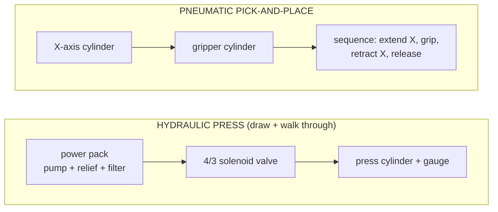
One stroke narration for the press: pump runs → valve shifts → cylinder extends (relief set ABOVE working pressure) → press operation → valve centres → load held.
**Where fluid power beats electric drives:** force density (hydraulics), explosion-safety (pneumatics), instant stall tolerance.

---

# THE NIGHT-BEFORE DRAWING LIST (20 marks every year)

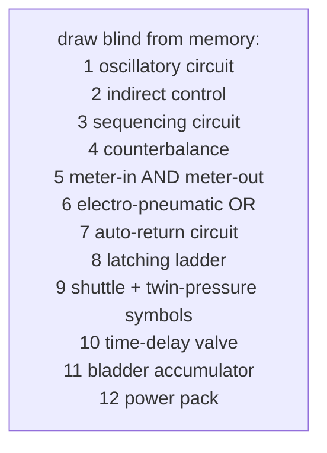

**Priority from paper analysis:** Q4+Q5 are pure drawing — drill the 12-circuit list above; then sequencing + counterbalance + pressure-comp FCV theory for Q3; pump construction for Q2.
