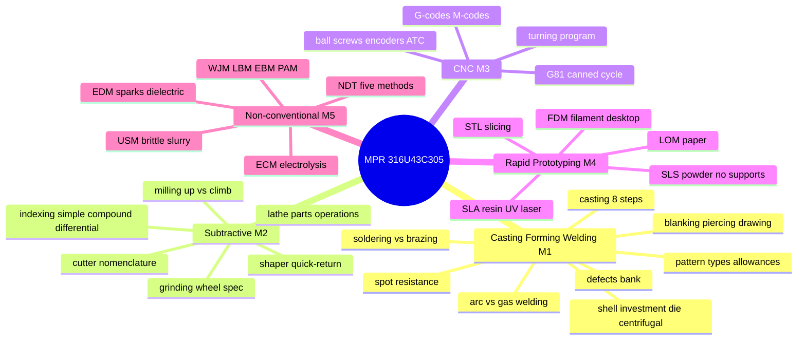
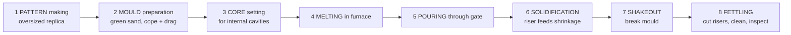
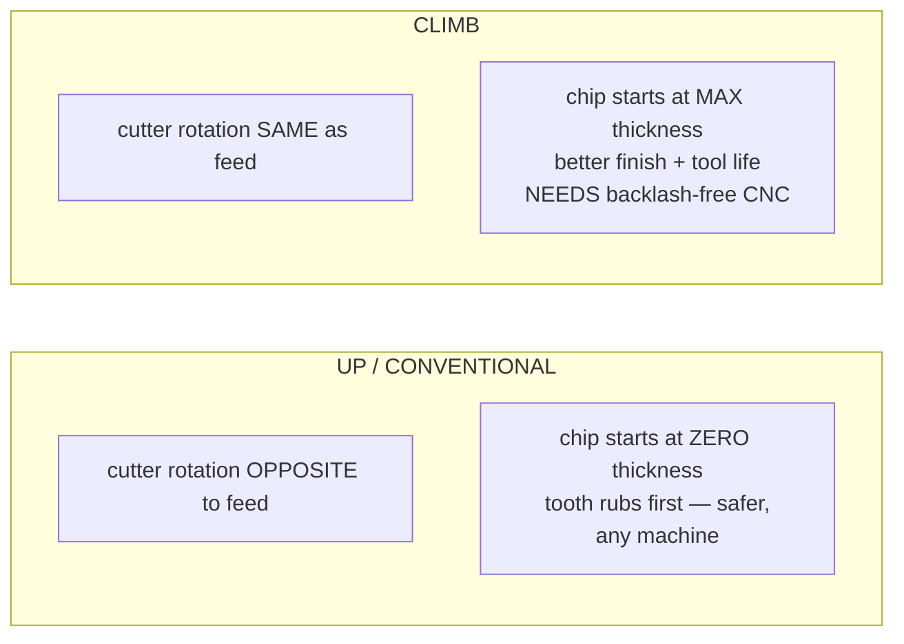
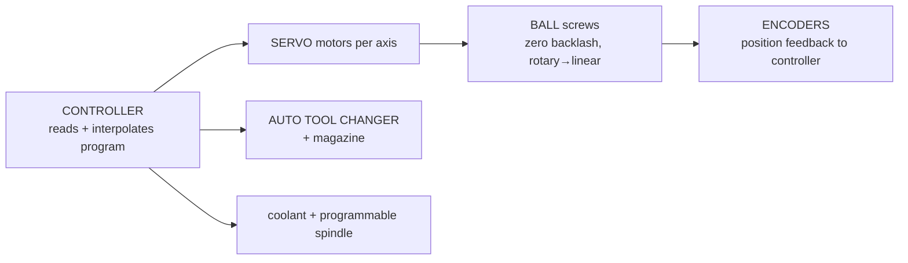
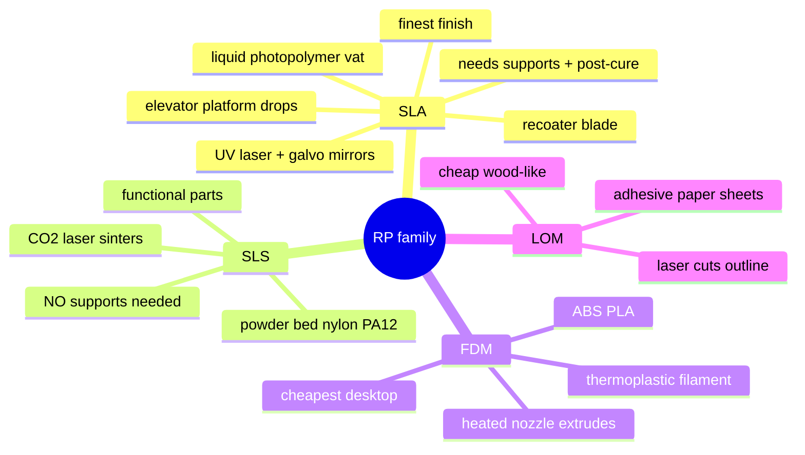
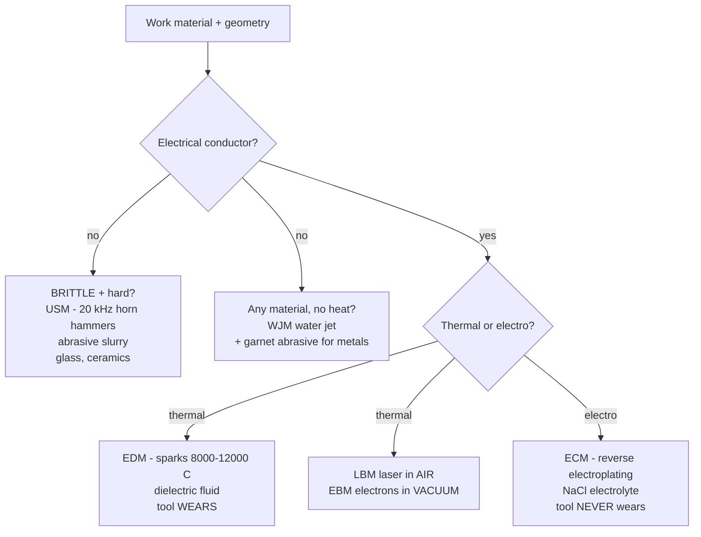
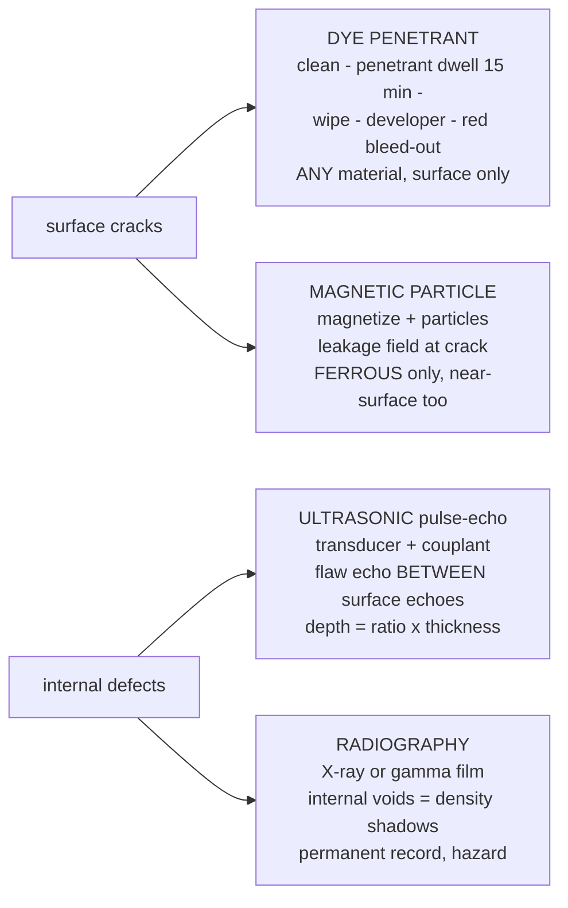
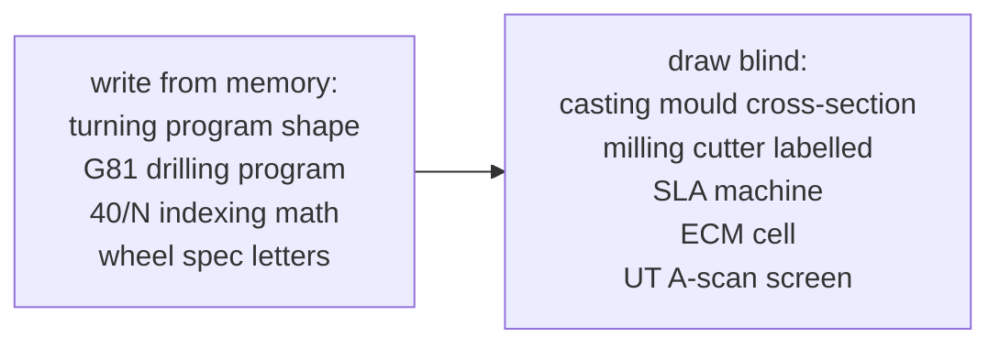

# MPR — The Complete Visual Study Guide
*Manufacturing Processes (316U43C305) · everything you must go over, in one file*
*Built from: RAI ND25 real paper + Prod ND25 sister paper + code-verified programs*

**How to use:** MPR pays for LABELLED SKETCHES + step sequences + CNC code. Every process below = principle, labelled parts to draw, working steps, advantages. The two full CNC programs (turning + G81 drilling) are exam-ready as written.

---

## 0 · THE SUBJECT IN ONE PICTURE + PAPER MAP



**ND25 paper map:** Q1 casting + definitions + arc-vs-gas · Q2 indexing + cutter nomenclature · Q3 CNC advantages + **turning program** + **G81 drilling** (20 marks CNC!) · Q4 SLA figure · Q5 ECM + ultrasonic testing.

---

# MODULE 1 — Casting, Forming, Welding

## 1.1 Steps of casting (ND25 Q1 — the ordered answer)


**Cross-section to draw:** cope + drag flask · pattern cavity · runner + gate (metal path) · riser (reservoir) · core · vent holes · parting line.

## 1.2 Patterns — types, materials, allowances
**Types:** solid/one-piece, split, match-plate, sweep, skeleton, loose-piece. **Materials:** wood (cheap, low life), aluminium (light, best all-round), cast iron (long life, heavy), plastic, wax (investment).
**The 5 allowances (name + purpose):** **shrinkage** (pattern larger — metal contracts), machining (extra metal on finished faces), **draft** (taper for pattern withdrawal), distortion, shake.

## 1.3 Moulding methods (know any ONE in depth + rest one-line)
- **Green sand:** clay + silica + water — cheapest, most used.
- **Shell moulding:** resin-coated sand against heated metal pattern → hard shell halves → fine finish, medium volume. Draw: heated pattern + dump box + shell.
- **CO₂ process:** sodium silicate sand gassed with CO₂ → instant hardening.
- **Investment (lost wax):** wax cluster → ceramic slurry dip → stucco → burnout → pour → break shell. Excellent finish, complex shapes — turbine blades.
- **Centrifugal:** mould spins, metal thrown outward — dense fine grain, pipes/liners, no risers.
- **Die casting (HPDC):** molten metal injected under high pressure into metal die — very high rate, non-ferrous. Gravity die (permanent mould): better quality, slower.

## 1.4 Casting defects (sketch each, cause + remedy)
**Blowholes** (gas entrapment — wet sand, insufficient vents) · **cold shut** (two fronts meet, don't fuse — low pour temp) · **misrun** (cavity unfilled — thin sections/low temp) · **shrinkage cavity** (riser too small) · **hot tears** (restrained contraction) · **sand wash/inclusions** · porosity.

## 1.5 Forming — definitions with sketches
**Rolling** — stock between rotating rolls (plates/sheets). **Forging** — compressive shaping between dies (cranks, spanners). **Extrusion** — billet pushed through die (rods/tubes). **Wire drawing** — pulled through successive dies.
**Blanking vs piercing (the confusable pair):** identical punch-and-die mechanics — **blanking: the cut-out SLUG is the product** (workpiece gets a hole? no — blank IS cut from sheet); **piercing: the HOLE is the product, slug is scrap.**
**Drawing (deep):** flat blank → cup. **Bending:** angle along a straight line.

## 1.6 Welding (ND25 asked arc vs gas)

| | Arc welding | Gas welding |
|---|---|---|
| Heat source | electric arc electrode–work ~6000–7000 °C | oxy-acetylene flame ~3100–3200 °C |
| Electrode/filler | flux-coated consumable | separate filler rod |
| Penetration/speed | deeper, faster | shallower, slower |
| Equipment | power supply + holder | cylinders + torch — portable, cheap |
| Best for | thicker structural | thin sheet, field repairs, no power |

**Spot/resistance:** current through overlapped sheets + pressure → fusion nugget at interface — car bodies (draw two electrodes + sheets + nugget). **Electroslag:** vertical thick plates, molten slag pool resistively heated. **Laser beam:** focused coherent light — tiny HAZ, precise, air. **Electron beam:** high-velocity electrons in VACUUM — deepest penetration, vacuum chamber needed.

## 1.7 Soldering vs brazing (Prod ND25 10-marker)
Both: filler melts, BASE metal does not. **Solder < 450 °C** (Sn-Pb, Sn-Cu) — electrical joints, plumbing, weaker. **Brazing > 450 °C** (Cu-Zn, silver alloys) — stronger, carbide tool tips, bicycle frames. Compare: temperature, strength, filler, application + joint sketches.

## 1.8 Welding defects + PCB
Defects: undercut, incomplete penetration, slag inclusion, porosity, spatter, distortion, cracks, overlap — sketch the bead cross-section with arrows.
**PCB steps (RAI hook):** FR4 substrate → copper cladding → drill → photoresist + etch (FeCl₃) → plating → solder mask → silkscreen → test.

---

# MODULE 2 — Subtractive Machining

## 2.1 Lathe — parts + operations
**Parts:** bed, headstock (spindle + chuck), tailstock (centres), carriage (saddle, cross-slide, compound, tool post), apron, lead screw, feed rod.
**Operations:** turning (reduce diameter), facing (flat end), taper turning (compound-slide at half-angle / tailstock offset / taper attachment), knurling, drilling, boring, parting, chamfering.
**Work-holding:** 3-jaw self-centring (round/hex), 4-jaw independent (square/off-centre), collet (precise small bars), faceplate (irregular), between centres.

## 2.2 Milling + up vs climb (Prod ND25 short)


Operations: face, slab, slotting, gear cutting, straddle, gang. **Universal milling:** table swivels — helical grooves, gears.

## 2.3 Indexing (ND25 Q2 — the math answer)
Purpose: divide work into equal angles (gear teeth, splines, bolt circles). Standard head = **40:1** (40 crank turns = 1 work revolution).
- **Simple:** crank turns = **40/N**. Example: 8 divisions → 5 full turns; 30 teeth → 1⅓ turns (1 + 13/39 plate hole).
- **Compound:** change gears multiply: (A/B)×(C/D) × 40/N — for N with awkward factors.
- **Differential:** index plate itself rotates via gear train from the spindle — for primes like 127.

## 2.4 Milling cutter nomenclature (ND25 — draw + label)
End mill/slab cutter: **tooth/face, rake angle (on tooth face), clearance/relief angle (flank), land, flute, cutting edge, body, arbor hole** — label primary + secondary clearance.

## 2.5 Shaper + quick-return
Ram carries tool; work feeds. **Whitworth quick-return:** cutting stroke slow, return fast (~2:1) — draw crank + slotted lever: crank pin drives the slotted bar; cutting arc > return arc. Operations: flat surfaces, slots, grooves, V-blocks, keyways.

## 2.6 Grinding + wheel spec
Types: surface (flat), cylindrical (between centres), **centerless** (work on blade between grinding + regulating wheel — no centres, high production), internal, tool & cutter.
**Wheel spec example 51-A-36-L-5-V-23:** abrasive (A = Al₂O₃) · grain size 36 · grade L (bond hardness) · structure 5 · bond V (vitrified). **Drilling vs reaming:** drill cuts the original hole; ream finishes an existing hole to size (multi-flute, tiny stock removal).

---

# MODULE 3 — CNC (the 20-mark center)

## 3.1 NC vs CNC + construction + advantages (ND25 10-marker)
**NC:** hardwired control from punched tape. **CNC:** dedicated mini-computer stores/edits programs at the machine.


**Classification:** point-to-point (drilling — position, then drill) vs continuous-path/contouring (milling/turning profiles); 2.5/3/4/5-axis.
**Advantages (write 6):** high repeatability, complex profiles, reduced operator skill, less WIP, CAD/CAM integration, fewer fixtures, less inspection.

## 3.2 G-codes / M-codes — the memorized table

| G | Meaning | | M | Meaning |
|---|---|---|---|---|
| G00 | rapid traverse | | M03/M04 | spindle CW/CCW |
| G01 | linear interpolation | | M05 | spindle stop |
| G02/G03 | arc CW/CCW | | M06 | tool change |
| G04 | dwell | | M08/M09 | coolant on/off |
| G28 | return home | | M00 | program stop |
| G40/41/42 | cutter comp off/L/R | | M02 | program end |
| G81 | drill cycle | | M30 | end + reset |
| G82/G83 | counterbore / peck | | | |
| G80 | cancel cycle | | | |
| G90/G91 | absolute / incremental | | | |
| G94/G95 | feed per min / per rev | | | |
| G96/G97 | constant surface speed / rpm | | | |

## 3.3 CNC TURNING part program (ND25 Q3 — write this shape)

```
%
O0001
N10 G21 G90 G97;          (mm, absolute, rpm mode)
N20 T0101;                 (tool 1 offset 1 - turning tool)
N30 M03 S800;              (spindle CW 800 rpm)
N40 G00 X47.0 Z2.0 M08;    (rapid approach, coolant on)
N50 G01 X45.0 F0.25;       (approach stock diameter)
N60 G01 X30.0 Z-20.0 F0.2; (cut to O30 at 20 mm length)
N70 G01 X20.0 W-10.0;      (step to O20, next 10 mm - W incremental)
N80 G00 X100.0 Z100.0 M09; (retract, coolant off)
N90 M05;
N100 M30;                  (end + reset)
%
```
**Turning conventions:** X = **DIAMETER** · Z = length from work face · F = mm/rev · S = rpm (G97) or m/min (G96). Explain each address: N block, G preparatory, X/Z/F/S/T/M.

## 3.4 Drilling with G81 canned cycle (ND25 Q3 — 4 holes)

```
%
O0002
N10 G21 G90 G80 G40;       (safety line: metric, absolute, cancels)
N20 G54 X0 Y0;             (work offset zero)
N30 M06 T02;               (tool 2 = O10 drill)
N40 M03 S1200 M08;
N50 G00 X10.0 Y10.0;       (rapid to hole 1)
N60 Z5.0;                  (approach plane R)
N70 G81 Z-15.0 R5.0 F100;  (canned cycle: drill depth 15, retract R)
N80 X50.0;                 (hole 2 - one block each!)
N90 Y30.0;                 (hole 3)
N100 X10.0;                (hole 4)
N110 G80;                  (cancel cycle)
N120 G00 Z50.0 M09;
N130 M05; N140 M30;
%
```
**Why canned cycle:** one block per hole replaces 6 move-blocks; G81 = drill → retract rapid; G82 adds dwell (flat-bottom counterbore); G83 pecks (deep holes — retract clears chips each Q increment); **G80 cancels.**

## 3.5 Word/address format
Each block = sequence of **words**; a word = **address letter + number**: N (sequence), G (preparatory), X/Y/Z (dimensions), F (feed), S (speed), T (tool), M (miscellaneous).

---

# MODULE 4 — Rapid Prototyping

## 4.1 The universal RP pipeline
**CAD → STL tessellation (triangles) → slicing into layers → machine builds layer-by-layer → post-process.**
Advantages: fast iteration, no tooling, complex geometry free, customization (medical). Disadvantages: material limits, anisotropy (weak across layers), surface finish, build-size limits.

## 4.2 The four machines (SLA asked ND25 Q4 — 10 marks)



**SLA full answer — draw: vat of liquid photopolymer, UV laser, galvanometer steering mirrors, elevator platform, recoater blade. Working: laser traces the layer cross-section → photopolymer solidifies → platform drops ~0.1 mm → recoater sweeps fresh resin → next layer bonds to the previous → after build: drain, solvent wash, UV post-cure oven. Advantages: highest accuracy + finest features. Limits: resin cost/brittleness, supports needed, degradation under UV.**

## 4.3 STL + slicing (overdue short)
STL = triangular facet mesh approximating the CAD surface (chordal tolerance controls quality vs file size). Slicing software cuts the model into horizontal layers, generating toolpaths/hatching + supports per layer.

## 4.4 Comparison table

| | SLA | SLS | FDM | LOM |
|---|---|---|---|---|
| Material | liquid resin | powder (nylon) | filament (ABS/PLA) | paper sheets |
| Accuracy | best | good | fair | poor-fair |
| Supports | needed | **none** (powder supports) | needed | none |
| Part strength | brittle | functional | anisotropic | wood-like |
| Cost | high | high | **lowest** | low |
| Use | visual masters | functional parts | prototypes, hobby | large cheap models |

---

# MODULE 5 — Non-Conventional Machining + NDT

## 5.1 The chooser



## 5.2 ECM (ND25 Q5a — full answer)
**Principle:** Faraday electrolysis — work (ANODE +) dissolves atom-by-atom into the flowing electrolyte; tool (CATHODE −) shapes the field → cavity mirror-image.
**Setup to draw:** tool, work, ~0.5 mm gap, electrolyte (NaCl/NaNO₃) pumped at high velocity, DC 5–20 V, high current.
**Working:** current density dissolves work at gap; electrolyte washes products away; feed maintains constant gap. **MRR by Faraday's law (MRR = AI/zFρ).**
**Advantages:** NO tool wear, NO thermal stress/HAZ, mirror finish, ANY conductor however hard. **Applications:** turbine blade airfoils, dies, deburring. **Limits:** corrosive electrolyte, high power, only conductors.

## 5.3 EDM
Controlled sparks (10⁴–10⁵ Hz) between tool and work submerged in dielectric (kerosene/deionized water); each spark 8000–12000 °C melts/vaporizes a micro-crater; servo maintains gap; dielectric flushed. Tool DOES wear (graphite/copper/tungsten). **Die-sinking** (3D cavity) vs **wire-cut** (2D profile with travelling wire). Only conductors; thin recast layer/HAZ; dies, moulds, carbide.

## 5.4 USM / WJM / LBM / EBM / PAM (one strong line each)
**USM:** 20 kHz transducer + horn hammers abrasive slurry (SiC/B₄C) into work — micro-chipping; BRITTLE materials only (glass, ceramics, carbide); no heat; low MRR; soft tool wears.
**WJM/AWJM:** 400 MPa water jet ~800–1000 m/s through sapphire nozzle; garnet abrasive for hard metals; NO HAZ, any material.
**LBM:** focused CO₂/Nd:YAG laser vaporizes — tiny holes, cutting, medical; in air; small HAZ; no contact.
**EBM:** high-velocity electrons in VACUUM — highest depth-to-width ratio; vacuum equipment expensive.
**PAM:** constricted arc → plasma ~20,000 °C — cuts THICK metal fast; rough edge, noise/glare.

## 5.5 NDT — the detection ladder (UT asked ND25)



**Ultrasonic testing full answer (ND25 Q5b):** piezoelectric transducer sends pulse through couplant; screen shows initial pulse → **flaw echo** → back-wall echo; flaw DEPTH = (flaw position ÷ back-wall position) × thickness. Thick sections, any material, needs skilled operator + couplant, awkward on complex geometry.

---

# THE NIGHT-BEFORE CHECKLIST



**Priority from paper analysis:** (1) CNC turning + G81 programs (20 marks across the paper), (2) SLA diagram, (3) casting steps + defects, (4) arc-vs-gas + soldering-brazing, (5) ECM + UT diagrams, (6) indexing + cutter nomenclature.
